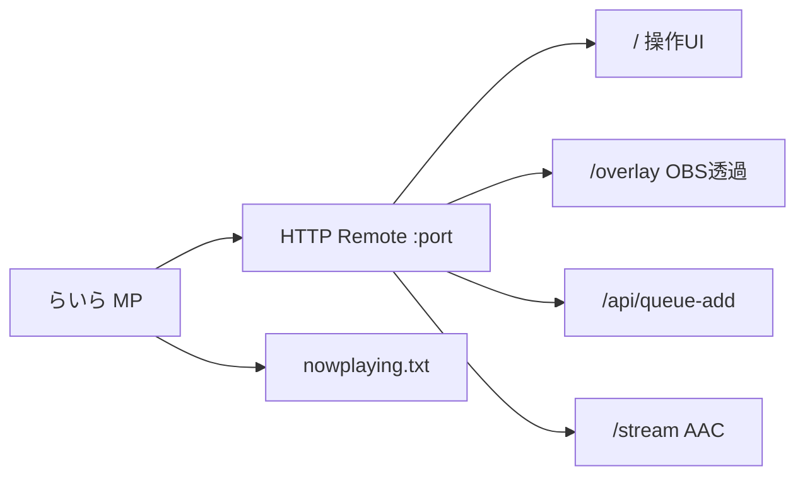
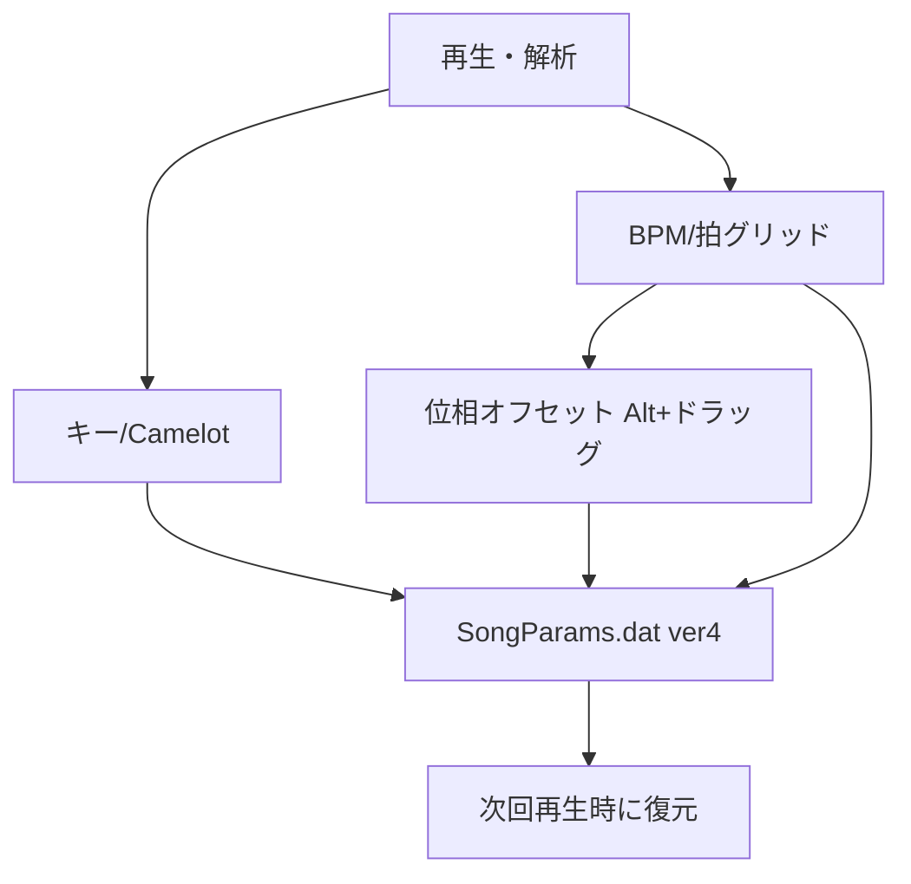
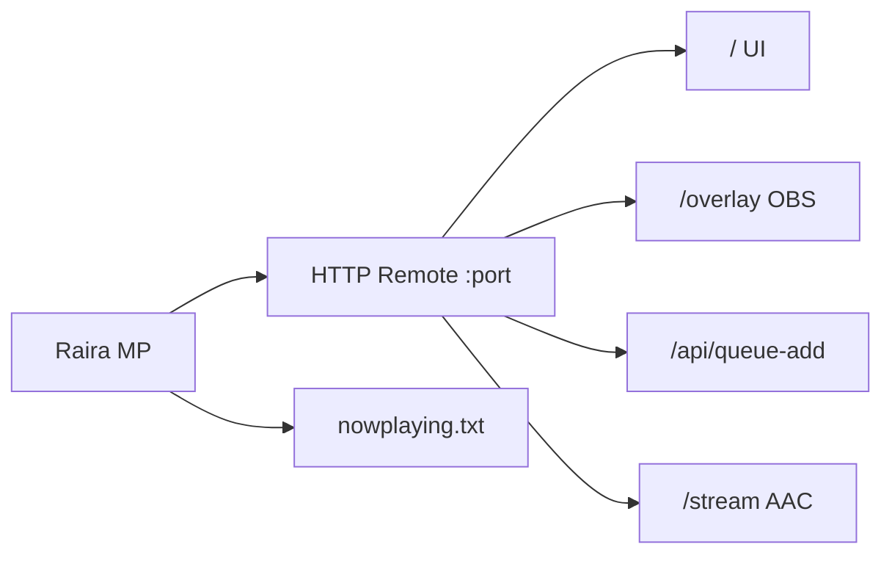
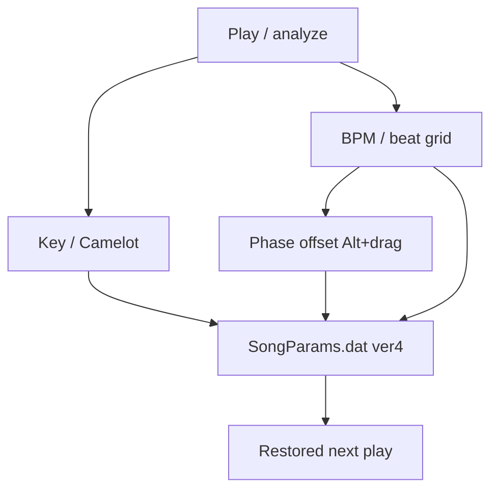

chachakotorinのgithubから移転です。

# oggYSEDbgm メディアプレイヤー「らいら」
日本ファルコム (Nihon Falcom) BGMプレイヤー / 高機能メディアプレイヤー
作曲「ささみ☆ミ」
本格派タクティクスRPG「らいらX」

**対応OS:** Windows 11 以降

## 概要
このソフトは、イースシリーズや軌跡シリーズなどの日本ファルコム作品のBGMファイル（Ogg, WAV, mp3等）を、**ゲーム中と同様にループ付きで再生**できるプレイヤーです。
また、DirectShowを使用した動画再生や、ハイレゾ音源（DSD/FLAC）の再生にも対応しています。
同じウィンドウから、曲を作る「ささみ☆ミ」と、ターン制の「らいらX」も開けます。それぞれの流れは、この説明のうしろにまとめてあります。

少し画面がグラフィカルになりました。
多言語化しました。
日本語"Japanese"、英語"English"、フランス語"Français"、イタリア語"Italiano"、スペイン語"Español"、韓国語"한국어"、中国語"中文"、アラビア語"العربية"、ロシア語"Русский"、ドイツ語"Deutsch"、ポルトガル語"Português"、オランダ語"Nederlands"、ポーランド語"Polski"、トルコ語"Türkçe"


### 環境モデル・イコライザー機能
イコライザー機能が追加され100種類の環境モデルや15バンドのイコライザーも実装されました。
イコライザープリセットも100個用意されています。
環境モデルで音割れ防止のため、楽曲が既に大きいボリュームの場合、ダイナミックコンプレッサーにより音割れしないよう処理が施されております。

グローバルパラメータとして、鮮明さ、低音域高音域バランス、音の密度、音の立体感、リバーブ、コーラス、ディレイも用意してあります。
これらは環境モデルとは別で動作します。
リバーブ／コーラス／ディレイは、スライダー後半でパンリバーブ、コーラスディストーション、マルチディレイ側にも振り分けられます。

また環境モデルのかかり方の度合いの変更できるため、かなり自由度が高くなっています。
現在のEQ／グローバル一式を **A/B スナップショット**として保存・適用・切替できます。

### ピアノロール機能
108鍵盤（表示レンジは 88／108 切替）のピアノロールが実装されました。右クリックメニューから操作でき、検出パラメータの微調整や、再生中のコード・メロディ表示、ノート名表示にも対応しています。再生（またはPC音譜面化）中の MIDI / MusicXML 録り（実験的）もできます。
表示は通常の2Dに加え **簡易3D**（視点ドラッグ・ホイールズーム）も選べます。

### MIDIモニタ
再生中の SMF（.mid / .midi / .kar / .rmi）を **32パート**（A01–A16 / B01–B16）で見守る画面です。オーディオから音程を推定するのではなく、ファイルに書かれた MIDI イベントそのものを出します。ピアノロールが「どの音が鳴ったか」を時間軸で見せるのに対し、こちらは各チャンネルの音色・音量・GS/XG の状態を一覧します。同じ窓で FM 側（SASAMI FPY / OPNA・YM2608 のレジスタと鍵盤）へ切り替えられます。表示は通常の2Dに加え **簡易3D** も選べます。バナー／プレイリスト／コマンドパレットから開けます。

### 波形・周波数アナライザー
Ozone風のリアルタイムアナライザーを追加しました。

- **上部:** 多チャンネルPCM波形（横スクロール）と L/R レベルメーター（RMS＋RMSピークホールド）。位相相関 φ はメーター左、レベルを消すと右端へ移ります
- **上部の描画:** スクロール波形／エンベロープ／M-S／ラウドネス履歴／トリガー式オシロ／残光オシロ（右クリック、または **W**）
- **下部:** 対数軸の周波数特性に加え、1/3oct RTA・スペクトログラム・位相スコープ・ゴニオ・帯域相関・帯域位相差（右クリック、または **S**）。簡易3Dでも同じ種類
- **表示モード（周波数特性）:** Ozone / Cubase Frequency / Voxengo SPAN / Ableton Spectrum / FabFilter Pro-Q / バー / 線のみ
- **波形速度:** x0.25〜x2.0（右クリック）
- **レイアウト:** 重ね描き / 上下分割 / 左右分割 / 2x2 / 2x4（右クリックメニュー）
- **EQオーバーレイ:** 既存15バンドEQの帯域とゲイン曲線をスペクトラム上に表示
- **マウス読取:** ホバーで周波数・dB・チャンネル（分割時はカーソル下のパネル）を表示。帯域相関は φ、帯域位相差は角度
- **操作:** フリーズ（F） / ピークホールド（P） / EQ表示（E） / メーター（M） / ピークリセット（Space・ダブルクリック）
- **描画:** 解析ワーカースレッド＋UI自由走行（ピアノロールと同様）。アクリル（ぼかし）モードにも対応

メディアプレイヤー画面モードの再生中アイコン（♪点滅2コマ）と選択♡の描画順も整備しました。

### メディアプレイヤー画面モード搭載
普通のメディアプレイヤーのようなモード「らいら」を搭載。起動時にファルコムBGM画面との切り替えもできます（起動モード確認ダイアログで「次回も確認」も選べます）。

シークバーまわりを強化しています。

- **波形オーバービュー:** シークバー上に波形を表示（再生しながらリアルタイムで埋まり、WAVはファイル全体の概観に差し替え）。右クリックでON/OFF
- **ループとA-Bの分離:** ピンク帯／つまみがループ範囲、青がA-B。ロックチェックでループつまみを固定（既定ロック）
- **キュー / フレーズA-B / 練習テンポ:** キュー追加・1〜8でジャンプ、Rで現在±秒をA-B、テンポは 50/75/100% プリセットに加え **50〜200%** の連続調整
- **ジャケット残時間リング**、バナー（バー／ミラー／波形／簡易3D）と位相相関メーター（φ/LR）、シーク上の細いスペアナリボン
- **シーク右クリック:** シーク／ループ／A-B の調整、A/B 点セット、キュー追加など
- **拍グリッド位相:** シーク上で **Alt+ドラッグ** すると拍線の位相（オフセット）をずらせます。BPM／キーと一緒に曲ごとに記憶されます
- **LRCマーカー:** シーク波形下に水色の時刻線。クリックでその位置へシーク（A-B候補にも使えます）。ホバーで局所拡大ルーペ
- **キー／Camelot:** ツール「キー確定」で解析キーを曲に保存。相性候補は現プレイリストから隣接キーを列挙
- **Up Next キュー**（一覧・並替）、**スマートプレイリスト**／**Lib（書庫）ツリー**（ルート追加・PC／スマートPLノード）、一時プレイリスト、欠損ヒート＋整理、重複ダイアログ、フォルダ同期リスト、★レーティング
- **セット章:** リスト右クリックで Warmup / Peak / Cooldown タグ（セット構成の目安）
- **書き出しクロスフェード帯プレビュー**、拍グリッド、LRC微調整、スリープ（カスタム分＋残り表示）
- **再生履歴タイムライン**（日付ヘッダ・最大64件）
- シークホバーで時刻チップ、A-B周回回数表示（L%d）
- プレイヤー内の **カラオケ風歌詞パネル**（スクロール表示。別窓の歌詞ウィンドウとは独立）

シーク周りのイメージ:

```text
 ┌──────────────────────────────────────────────┐
 │  波形オーバービュー（最奥）                    │
 │  ┃ ┃ ┃ ┃  拍グリッド（Alt+ドラッグで位相）      │
 │  ┊ ┊ ┊     LRC 水色マーカー（クリックでシーク） │
 │  ████ピンク=ループ██  青A──青B   ♥再生位置     │
 └──────────────────────────────────────────────┘
```

キー相性（Camelot）のイメージ:

```text
        7B   8B   9B
        7A  [8A]  9A     ← 現在キーの隣接＋相対が「相性候補」
```

### テンポ・ピッチ変更
再生中のテンポとピッチを、それぞれ独立して変えられます。

### 歌詞表示
.lrc形式の歌詞表示に対応しています。ネットからの歌詞取得（LRCLib／NetEase など）もできます。常時最前面の歌詞ウィンドウや、LRCの細かいずれ補正・保存も使えます。

### ジャケット・プレイリスト
アルバムジャケットの表示と、プレイリスト機能（m3u / m3u8 / pls / xspf の取り込みなど）があります。曲ごとの音量やEQなどの設定も覚えます。
「曲ごとに設定保存」のチェックを入れると、★付きの曲は保存済みパラメータを読み直して反映します。チェックを外すときは、その時点の設定をその曲へ保存してから無効化します。
フォルダの `cover.jpg` や代替ジャケットの再読込・画像保存にも対応しています。
曲名の色印で、曲ごと保存（橙）・歌詞（青）・WRD（桃）・チャンネル数・MIDI などを見分けられます。

### 連続再生クロスフェード
**連続再生 ON** のとき、メイン／メディプレのチェックと秒数（小数可・既定 5.00 秒）で、曲末から指定秒だけ次曲と等パワーで重ねてシームレスに切り替えます（書き出し用のクロスフェードとは別系統）。

- 終端手前で次曲を裏で soft-open し、指定秒のあいだ A/B を混合してから本流を次曲へ昇格
- 昇格時にプレイリストの♪・ジャケット差し替え・リストの時間／タグ欄を更新
- 動画扱いや再生できない行は飛ばして、次の音声曲へ進みます
- **WAVへ保存** と併用すると「チェック用」モードになり、最初に流した曲名の WAV へ追記し続けます。出力は余裕を見て **96 kHz / 2ch / 24bit**（聞こえている混合 PCM を変換）に固定。停止でファイルを確定します

### アクリル（ぼかし）UI
Windows 11のアクリル風ぼかし表示に対応しています。コンテキストメニューの「アクリルモード」から、設定を開かずに ON/OFF できます。

### コンテキストメニュー（描画・フォント）
カスタムコンテキストメニューの **メニュー描画方法**（出現／消失アニメ）を選べます。選んだ内容は保存され、次に開くメニューから反映されます。

- クラシック（フェード）／上下に伸びる／カーテン（上から）／ワイプ（横）／リップル（起点）
- ビッグバン／ブラックホール／螺旋（スパイラル）／花びら／ジッパー（左右交互）／オーロラ（波・既定）

メニュー用フォント（8–24pt、太字／斜体）もホバープレビュー付きで変更できます。**立体アクセント強め** で、区切りや行の立体表現を強くできます。

見た目の色と輪郭は **テーマ** でまとめて替えられます。既定は **可愛い**。コンテキストメニューから、格好いい／中二／夜光／墨／森／キャンディ／鋼、超可愛い／超格好いい、春・夏・秋・冬、夕暮れ／朝／雨／海／月／琥珀／藤、レトロ、清楚・学園・ゴシック（女／男）、ぶっ壊れ、天界／廃墟／神社／星空／深海／花園／薔薇／蝶。ボタンや区切りの色・印までテーマに揃います。選んだテーマは次回も残ります。

### 覚えておく設定
ウィンドウの位置、音のつまみ、リストの終わり方などは、終了しても次に開いたときに戻ります。曲そのものの音量やキーは曲ごと設定（★）側、画面の置き方や再生の決まりごとはアプリ側、という分けです。

**リストの進み方**

- **連続再生** はリストを最後まで進めます。**ループ再生** は今の曲、または選んだ区間を繰り返します。**ランダム再生** はメディプレのリスト順です（ファルコム画面のランダムとは別です）
- **終了動作** はリストの最後でどうするかです。**最後で停止**／**同じリストを繰返し**（既定）／**次のリストへ**（最後のリストでは停止）／**全リストを循環**（最後のリストのあと先頭のリストへ）
- **ループ回数** は無制限か、指定した回数です。回数の上限はとても大きく取れます
- **クロスフェード** は連続再生のとき曲のつなぎで重ねます。ループしている曲は、5分の時点でも一度クロスフェードします

**検索**

検索語は、絞り込み ON だと一致した曲だけを出し、OFF だと ▲▼ で前後の一致へ飛びます。**正規表現** を入れると大小文字を区別しない ECMAScript の式です（例: `^Ys|空の軌跡$`）。式が壊れているときは一致なしになります。

**窓の位置は画面モードごと**

ファルコムBGM画面とメディアプレイヤー画面で、EQ・ピアノロール・アナライザー・MIDIモニタ・WRD・検出パラメータ・プレイリスト追随の位置と開閉を別々に覚えます。片方で動かしても、もう片方の置き場所は崩れません。メインを動かすと、追随ロックのついたサブ窓が付いてきます。

**音量の系統**

主音量、EQマスター、拡張音量は別です。さらに kpi／mp3／Winamp系プラグイン／CEmu は、フォーマットごとの音量段階を持てます。テンポとピッチのスライダー位置も次回に残ります（200 が 100%）。

**MIDI の出し先**

プレイリストの SMF は、レンダリングの「MIDI再生」で KPI優先／VST優先／VSTホスト優先を選びます。GS 用と XG 用の VST（または .sf2）は別欄です。SoundFont のパスを空にすると、プラグインと同じ場所の SGM 系 .sf2 を探します。欄に .sf2 を直接書いたときは、そのファイルを使います。

LA を Windows の MIDI マッパーや MIDI 出力へ出すときだけ、**SC モジュール**（バンク MSB 127 / LSB 0）か **実機 MT-32**（バンクを出さずプログラムだけ）かを選べます。繋がっているのがどちらかは自動では分かりません。VST（SOUND Canvas VA など）へ出すときは、こちらに関係なくバンク 127 です。

ピアノロールと MIDI モニタには、MIDI In を2系統まで名前で覚えられます。MIDI Out は「なし」「MIDI マッパー」「機器名」です。

**CEmu**

データフォルダが空のときは、実行ファイルの隣の `data` を見ます。**G.I.M.I.C** は既定ではソフトのままです。レンダリングで実機にすると、対応チップの曲を実機へ出します。CEmu の音量段階も別です。実行ファイルの隣に `arcdata.zip`（または `.7z`）があるとき、Cemu対応一覧にタイトルが出ます。

**画面キャプチャの足し**

録画モードはプライマリ／全モニタ／ウィンドウ合成に加え、**特定のモニタ** も選べます。マウスカーソルを載せるか、システム音、マイク、FPS、出力解像度、MPの曲を合成に含めるかは次回も残ります。効果は先頭だけでなくチェーン（最大8段）で、段ごとの強さがあります。配線は名前付きで16個まで覚えられ、選んでいるプリセットも残ります。ライブ配信（YouTube のトークンや RTMP の URL／キー）も、入れた内容は次に開いたときに残っています。

**更新の聞き方**

起動時の更新確認は、毎回聞く／新しい版があればそのまま更新する／次回から聞かない、を覚えます。演奏中の定期チェックからは、自動更新がオンでも勝手には更新しません。上書きに失敗したときは、次回起動で「ダウンロード」フォルダへ手動展開する案内に回します。サイトへの回数加算は、直近1日ですでに足していれば重ねません。

**Soft3D の画**

迷路と空中レースの窓位置、難易度、相手、テーマ、アイテムの種類、ズームは次回も残ります。迷路は歩行の揺れ、視野（55°／70°／90° を基準にホイールと合成）、地下の階数、進行の自動保存もあります。メッシュの密度は軽量〜緻密〜美麗、グラフィック品質は 1〜10 で、GPU に任せるか自分で固定するかを選べます。PCM の効果音はオフにもできます。

**ボイスチェンジャーのつまみ**

男女・年齢のプリセットに加え、明るさ、息、音質（低遅延／高音質）、かかり（通常／ロボット／ラジオ）を覚えます。**マイクへ適用** を入れると、メディアプレイヤーや画面キャプチャのマイクミックスにも同じ設定が乗ります。

### 操作ガイド
メディアプレイヤーの「？」に加え、EQ・プレイリスト・動画・レンダリング・キャプチャ・アナライザ・ピアノロール・メイン画面など、各 UI から **操作ガイド**（GDIヘルプ）を開けます。コンテキストメニューの「操作ガイド」からも到達できます。

タイトルバーの **本** ボタンや **F1** では、オフラインヘルプ（CHM）全体が開きます。「？」がその画面だけの短い図解なのに対し、本／F1 は目次つきの説明です。

**コマンドパレット**で機能名の一部を打てば、メニューをたどらずに目的の画面へ飛べます（「あの機能どこだっけ」のとき向きです）。

操作ガイドには、画面ミニマップに加え、**シーク層（波形／拍グリッド／LRC／ループ・A-B）**、**Camelot相性**、**セット章**、**Remote/OBS** などの図解も入っています。追加機能の位置づけが分かりにくいときは、まずここを開くと把握しやすいです。

### PCMアップスケール
サンプリングレートやビット深度のアップスケール、マルチチャンネル出力に対応しています。スピーカーはステレオ／2.1／4ch／5.1／7.1／オリジナル（マッピングなし）から選べ、サラウンド量は 0〜100 です。

### 演奏プロンプト
再生中にピッチやテンポ、エフェクトなどを時間指定で動かすプロンプト機能があります。テキスト編集のほか、曲を読みながらの解析・履歴の保存／読込、雰囲気モードにも対応しています。

### コマンドロール
プロンプトを時間軸のロール上で編集・配置できます（複数レーン）。メディアプレイヤー側から開けます。メイン画面に追随するロックや表示倍率の保存にも対応しています。簡易3D表示もあります。

### VSTホスト
メディアプレイヤー下段の **VST** から、手持ちの VST 音源を読み込んで鍵盤で鳴らせます。プラグインを Part 1〜32 へドラッグして配線し、MIDI入力（最大3系統）と音声出力を選べます。プリセットの保存・切替、名前での絞り込み、再スキャンに対応。MIDI機器が無くてもパソコンのキーボードで簡易演奏できます（Space で全音停止）。SOUND Canvas VA のようなマルチティンバーは1スロットで16chを受け持ちます。32bit プラグインは ogghost32 経由です（ogghost32.exe は実行ファイルと同じフォルダ階層の x86）。

プレイリストの **.mid / .midi / .kar / .rmi** は、レンダリング設定の「MIDI再生」で鳴らします。**KPI優先** は kpi、**VST優先** は GS／XG 用の VST または SoundFont（.sf2。XG System On があれば XG、無ければ GS）、**VSTホスト優先** は VSTホストで保存したプリセットです。明示の DLL が空なら MIDI出力の機器（未指定は Windows MIDI マッパー）になります。

### WRD画面
PC-98 の MIMPI / TMIDI 用 .wrd を、テキストと16色グラフィックで再生する画面です。ウィンドウメニューやコマンドパレットから開けます。

### 作曲「ささみ☆ミ」
ツールの「ささみ関連コンポーザ」から開く作曲机です。文字、五線、ピアノロールで曲を書き、らいらで鳴らせます。画面の流れは、うしろの「作曲「ささみ☆ミ」」にまとめてあります。

### CDプレイヤー
下段の **CD** から、CDの再生・取り込み・曲目検索・書き込みができます。

### 再生詳細
ギャップレス、ReplayGain、Mid/Side、相関メーター、書き出しリミッター、ループ区間、ループ境界フェード、キュー、タグ書き込み、簡易波形プレビューなどをまとめた設定です。メディアプレイヤー画面の「詳細」ボタン、またはプレイリストの右クリックから開けます。
タグ書き込みは **MP3 / FLAC / WAV / M4A / Ogg Vorbis** に対応しています（暗号化FLACやOpus書き込みは非対応）。

### ファイル情報
プレイリストやメディアプレイヤーの右クリック「ファイル情報」から、曲の表示名・アーティスト・アルバム・パス、タグ、ループなどを確認・編集できます。

- タグ→プレイリスト反映、タグ再読込、タグ書き込み（上記フォーマット）
- パス参照／Explorerで選択表示／パスコピー／ファイル名コピー
- ファイルの有無・拡張子・サイズ表示、曲ごと設定（★）の表示と削除
- 再生詳細へのジャンプ、ループの編集（OKでプレイリストへ保存）
- 複数選択時はアーティスト／アルバムの一括編集

### タグ編集
プレイリストの右クリック「タグ編集」から、タイトル／アーティスト／アルバムに加え、年・トラック・ジャンル・コメントやジャケットを編集してファイルへ書き込めます。複数選択時は空欄の項目は変えず、入力した項目だけ一括適用します。

### 音声書き出し（WAV / mp3 / FLAC）
プレイリストの右クリック「音声書き出し」から、選択曲を **WAV / mp3 / FLAC** に書き出せます（タブで形式切替）。いったん PCM（WAV経路）へレンダリングしたあと、必要ならエンコードします。

- **ループ回数**、**フェードアウト**、**先頭無音を揃える**（長い先頭無音はカット、短い場合は無音を足して指定秒に揃える）
- **サンプリング**（ソースのまま／44.1〜192 kHz）、KPI曲向けの**長さ(秒)**
- **タグとジャケットをコピー**、タイトル／アーティスト／アルバム／ジャケットの指定
- **プロンプト実行を適用**（書き出しPCMに演奏プロンプトを反映）
- **クロスフェード**（複数選択時）: 曲を1ファイルに順次連結し、曲間を指定秒で等パワー交差。コンテキストの「クロスフェード書き出し」からも起動可
- **ミックス**（複数選択時）: 同時に重ねる曲数と曲ごとの音量割合(%)を指定して1ファイルへ。クロスフェードと併用すると、終わった枠へ次曲を指定秒で補充投入

従来の WAV 書き出しと同様、2GB超は RF64 に対応しています。

### マイクミックス（再生中WAVへ）
「WAVへ保存」がONのとき、再生PCMにマイク入力をミックスして書き込めます。マイク端末はレンダリング設定（CRender）側で選び、ミックス量は0〜200%です。メディアプレイヤーのプレイリスト右クリックからもON/OFFできます。
連続再生クロスフェードと併用したときのチェック用ダンプ（96 kHz / 2ch / 24bit・先頭曲名へ追記）については、上記「連続再生クロスフェード」を参照してください。

### デバイス録音
メディアプレイヤー下段の「録音」から、再生端末のループバックを **WAV / mp3 / FLAC** に録音できます。端末・形式・品質・保存先を指定でき、マイクの同時ミックスにも対応しています。mp3 / FLAC はいったんWAV経由で変換します。

### アナログ起こし台
レコードプレイヤーやカセット、ラジオなど **外から入る音** を WAV / mp3 / FLAC に録音します（下段やツールから）。入力端末のほか、**HPF**（ランブル対策）、**Gain**、**Gate**（曲間ノイズ抑え）、モニタ出力を備え、メーターを見ながらレベルを合わせられます。mp3 / FLAC はデバイス録音と同じく WAV 経由です。

### 画面キャプチャ
同じく下段の「キャプチャ」から、画面を **MP4（H.264 + AAC）** で録画できます。**ライブ配信モード**では MP4 を作らず、ffmpeg 経由で YouTube Live / ニコニコ / カスタム RTMP へ送ります。

- **モード:** プライマリ画面 / 全モニタ（仮想デスクトップ） / ウィンドウ合成
- **ウィンドウ合成:** 複数ウィンドウをレイヤとして配置。プレビュー上でドラッグ移動・四隅での拡大縮小、Z順の入れ替え
- **システム音**（ループバック）と**マイク**の有無、FPS、出力解像度
- **MPの曲を載せる:** 開いているメディアプレイヤー画面を合成に含め、配置・サイズを調整可能
- プレビューは録画中も更新されます（枠やHUDは録画ファイルには入りません）
- **ライブ配信:** Live チェック ON。YouTube は Google OAuth Client ID/Secret → 認証 → 配信枠作成（タイトル／公開・限定・非公開）→ 配信開始。ニコニコ／カスタムは配信ページの RTMP URL＋キーを入力。実行ファイルと同じ場所に **ffmpeg.exe** が必要です（無いときは配信画面から公式ビルドを取得できます）

### 附属ツール（らいら）
メディアプレイヤーのツール右クリック／各ウィンドウの右クリックから使える、プレイヤー附属の便利機能です。

- **歌詞ウィンドウ:** 常時最前面の歌詞表示。透明度・表示行数・フォント・位置を覚えます。LRC は ±10/±50/±100ms のずれ補正とファイル保存にも対応。メディアプレイヤーの歌詞▾右クリックからも開けます
- **ピアノロール拡張:** 再生中の MIDI / MusicXML 録り（実験的・停止時はPC音自動連動）、コード進行パネル、PC音（ループバック）の譜面化
- **スペクトロジャケット:** アナライザ表示を画像として保存
- **A-B／キュー素材パック:** A-B やキュー区間を連番で書き出し
- **音量正規化バッチ:** 選択曲を目標ラウドネス寄りに書き出し（リミッタ併用）
- **MusicBrainz 自動タグ:** 曲名・アーティストなどから候補を引いてタグ反映（指紋照合なし）
- **ボーカルキャンセル／強調:** Mid 成分の減衰・強調。ProTools から操作
- **M/S プリセット:** 相関まわりから狭める／広げる／モノをワンクリック
- **キー→EQ提案:** 検出キーからプリセットを提案
- **BPM計測:** 再生またはPC音を聴きながらチェックONで計測し、OFFで拍グリッドや書き出しクロスフェード秒に反映
- **キー確定／Camelot相性:** 解析キーを曲ごとに記憶。ツールから相性候補（隣接キー）を次曲候補として列挙
- **DJパッド:** ピッチ／テンポ／ボーカル／M/S に加え、レコードスクラッチ、Kill（低／中／高）、±拍、ホットキュー、A-B、フィルタ／FX／速度、3バンドEQ などをワンタッチ
- **MIDIキーボード操作:** ノート／CC で再生・次曲・音量など。**MIDI学習**で CC をテンポ／EQ 帯へ割り当て可能
- **ボイスチェンジャー:** マイクの声をリアルタイムに変換（男女・年齢などのプリセット、ピッチ／フォルマント／息、ロボット／ラジオFX）。変えた声はほかのアプリのマイク入力にも回せます
- **チューナー道場:** 単音チューナー（音名・セント、A4基準）とメトロノーム。フレーズA-Bで再生位置前後を練習範囲にできます（趣味用途・和音は非対応）
- **騒音計:** マイク入力を相対 dBFS で表示（Hold・応答の速さ）。校正SPL計ではありません
- **フォトフレーム:** フォルダ内の JPG/PNG/BMP/GIF を最大512枚、クロスフェードのスライドショー（シャッフル／最前面／BGM）
- **コマンドパレット:** 機能名の一部を打って画面を開く
- **トランジション・プリセット:** EQスイープ／フィルタ／クロスフェード秒の数種を「次曲向け」に適用（時系列オートメーション本体はなし）
- **ライブセット録画:** 画面キャプチャとデバイス録音をまとめて開く（ゲーム録画プリセットの拡張）
- **動画の音声抽出／差し替え:** 選択動画から WAV 抽出、または外部 WAV で音声を差し替えて MP4 へ書き出し
- **出力ミラー:** 別再生デバイスへ同じミックスをミラー（音量のみ別）。**Mirror CUE** 切替と独立ゲインあり
- **スクリーンセーバー風ビジュアライザ:** フルスクリーン表示（ESCで解除）
- **ローカルリモート:** 同じ Wi-Fi / LAN 上の PC・スマホ（同時最大6台）からブラウザで再生操作。操作／EQ／プレイリスト／歌詞／DJスクラッチ（レコード盤）／ピアノ／アナ のタブ。設定に表示される `http://（LANのIP）:ポート/` を開く（PC では `127.0.0.1` でも可）。インターネットへの公開はしません。初回は Windows ファイアウォールの許可が必要なことがあります
  - **OBS用** `http://…/overlay` …… 透過タイトル／状態の簡易HTML
  - **共同キュー** `…/api/queue-add?i=行番号` …… ローカル用途（認証なし・既存Remoteと同水準）
  - **AACプロファイル** …… 128 / 192 / 低遅延96 kbps 切替
- **nowplaying.txt:** 実行ファイルと同じ場所へ現在曲を書き出し（Discord本体連携はファイル出力のみ）
- **フォーカスモード／危険操作確認／レイアウト1–3／週次サマリ／練習ログ** …… ツールメニューから
- **アラーム:** 指定時刻に再生開始（スリープタイマーは従来どおり）
- **ゲーム録画プリセット:** 画面キャプチャ＋デバイス録音を所定設定でまとめて開く（ネット配信ではない）
- **Cemu対応一覧:** 実行ファイルと同じ場所に arcdata.zip（または .7z）があるとき、対応タイトルを一覧します
- **リスト編集の1段Undo:** 直前の削除／貼り付けを戻せます（Ctrl+Z。フル履歴Undoではありません）

Remote / OBS の関係:



曲パラメータ（記憶）の流れ:




## 対応ゲームタイトル
以下のゲームのBGMループ再生に対応しています。

### イース (Ys) シリーズ
- イース6 ナプシュテムの匣
- イース フェルガナの誓い
- イース・オリジン
- Ys I&II Chronicles / 完全版
- Steam版 Ys セルセタの樹海
- Steam版 Ys VIII (Ys8)
- Steam版 Ys IX (Ys9)
- Steam版 Ys X (Ys10)

### 軌跡 (Trails) シリーズ
- 英雄伝説6 空の軌跡 FC / SC / The 3rd (Steam版 The 1st / The 2nd含む)
- 英雄伝説 零の軌跡
- 英雄伝説 碧の軌跡
- Steam版 閃の軌跡 I / II / III / IV
- Steam版 創の軌跡
- Steam版 黎の軌跡 II
- Steam版 界の軌跡

### その他のファルコム作品 / 他社作品
- Zwei!! (CD版はADPCM、DVD版WAVはPCM処理)
- Zwei II
- XANADU NEXT
- アークトゥルス
- ぐるみん (※データ頭のRIFF検索によるADPCM対応)
- ソーサリアン オリジナル
- ダイナソア リザレクション
- ブランディッシュ4 眠れる神の塔
- **ガガーブトリロジー三部作**
  - 白き魔女
  - 朱紅い雫
  - 海の檻歌
- 西風の狂詩曲 (ラプソディー)
- 月影のデスティニー (mp3)
- 幻想三国志 1 / 2 (mp3)

## 主な機能

### 1. ゲームBGM再生・変換
- **ループ再生:** ゲーム内と同じように自然にループ再生します。
- **フォーマット変換:** Ogg, mp3などのゲーム内BGMをWAVファイルに変換可能です。Ver0.4b以降はフェードアウト機能にも対応。
- **フォルダ設定:** インストールされているゲームフォルダを指定して読み込みます（初期設定はデフォルトインストールフォルダ）。

### 2. 一般オーディオ再生
以下のフォーマットの再生に対応しています。
- mp3, m4a, aac, alac, flac, tta, ape
- DSD (dsf, dff)
- OggOpus (48k)
- Kb Media Playerの旧kpiと新kpi（ほぼ網羅）、Winamp / XMPlay / AIMP の入力プラグインに対応しています。実行ファイルと同じフォルダ階層に置いて使います。本体は x64。32bit のプラグインは、同じフォルダ階層の ogghost32.exe（x86）経由です
  - kpi一覧では拡張子テキストで絞り込みできます（入力すると即座に反映。チェック状態は曲単位で保持）

### 3. 動画再生 (DirectShow)
avi, mpg, mp4, mkv などのDirectShow対応動画を再生可能です。Windows Vista以降ではEVRを使用し、高画質で再生します。映像・音声・字幕ストリームの切り替えにも対応しています。
※ avi等の再生にはコーデックパック（K-Lite Codec Pack等）が必要です。
[解説サイト: ppp.oohara.jp/k-lite.html](http://ppp.oohara.jp/k-lite.html)

#### 動画再生中の操作・ショートカット

| 操作 | 機能 |
| :--- | :--- |
| **右クリック** | 画面サイズ変更 (1倍 / 1.5倍 / 2倍) |
| **ダブルクリック** | フルスクリーン切り替え |
| **ホイール / ドラッグ** | ウィンドウサイズ変更 |
| **C キー** | 一時停止 |
| **↑ / ↓ キー** | 音量調整 |
| **← / → キー** | シーク (早送り/巻き戻し) |

### 補足
- ランダム再生、連続再生、ループ回数の指定、A-Bリピート
- **連続再生クロスフェード**（曲末の等パワー混合・秒数指定。書き出しクロスフェードとは別）
- シーク波形オーバービュー、ループつまみロック、Up Next、スリープタイマー
- ファイルのドラッグ＆ドロップ追加
- mp3やDirectShow再生の途中位置の保存
- 音声書き出し（WAV / mp3 / FLAC。ループ／フェード／先頭無音揃え／クロスフェード／同時ミックス／サンプリング指定）
- WAV書き出し時の2GB超対応（RF64）
- マイクミックス（WAVへ保存時）、デバイス録音（ループバック→WAV/mp3/FLAC）、画面キャプチャ（MP4）
- 連続再生クロスフェードON時のWAV保存チェック用ダンプ（先頭曲名へ追記・96k/2ch/24bit）
- 歌詞ウィンドウ、LRC微調整／保存、ピアノロールのMIDI・MusicXML録り、PC音譜面化、簡易3D表示
- A-B／キュー素材パック、音量正規化バッチ、MusicBrainz自動タグ、ボーカルMid、M/Sプリセット、キーEQ提案
- BPM計測、DJパッド（スクラッチ／Kill／ホットキュー等）、MIDI操作、動画音声抽出、出力ミラー、SS風ビジュアライザ
- ローカルリモート（LAN／同時6台・タブ：操作/EQ/リスト/歌詞/DJスクラッチ/ピアノ/アナ）、アラーム、ゲーム録画プリセット、画面キャプチャのライブ配信（YouTube API / RTMP）
- ピアノロールの検出パラメータ調整ダイアログ（多数スライダー）、88／108鍵レンジ
- プレイリストからアナライザー／ピアノロールを直接開く
- 並べ替え、他プレイリストへの移動・コピー、選択曲のジャケ再取得、一時プレイリスト
- 欠損ファイル確認（パス修正・適用・インライン編集）と欠損マークの再スキャン
- プレイリスト取り込み（m3u / m3u8 / pls / xspf。UTF-8、相対パス、欠損／重複スキップなど）
- レンダリング設定（デバイス、バッファ、ビット深度、スピーカー／サラウンド、フォント、ファイル関連付け、**言語（14言語）**、スペアナ音階モード、MIDI再生の優先など）
- ファイル関連付けは音声に加え動画（avi/mp4/mkv/wmv/mov/webm 等）とプレイリスト（m3u 等）にも対応
- タスクバーのジャンプリスト（最近再生した曲、再演奏／停止／前後曲、EQ、ジャケット、レンダ、フォルダなど）
- タスクバーサムネイルツールバー（再演奏／一時停止／停止／次曲など）
- コンテキストメニューの描画アニメ・フォント、アクリル即切替、各窓の操作ガイド
- 起動時・定期の更新チェック（毎回聞く／自動／聞かない。定期チェックは演奏中に勝手に更新しない）
- リスト終了動作（停止／同じリスト／次リスト／全リスト循環）、メディプレのランダム、正規表現検索
- メニューの見た目テーマ（既定は可愛い）
- ファルコム画面とメディプレでサブ窓の位置を別々に記憶
- Windowsミキサーでアプリがミュートされているときの警告
- メディアプレイヤー側の最小化連動やツールチップ表示など
- メイン画面を動かすと関連ウィンドウが追随（各サブ窓の追随ロック）
- 曲ごと設定のON/OFF時の復元・保存、ファイル情報／タグ編集画面の操作
- タグ書き込み（MP3 / FLAC / WAV / M4A / Ogg Vorbis）
- kpi一覧の拡張子絞り込み
- 拡張音量（主音量／EQマスターとは別系統）
- Soft3D迷路（おまけ・下段ボタンから。地下階層・曲連動アイテムあり）
- Soft3D空中レース（おまけ・下段の「レース」。光帯コース・AI対戦・テーマ地形）
- 本格派タクティクス「らいらX」（下段「おまけ」またはツール。ターン制。キャラ作成・育成・店・錬金。流れはうしろの節）
- VSTホスト（下段「VST」。パート配線・鍵盤演奏）と、.mid の再生（KPI優先／VST優先／VSTホストのプリセット。GS/XG は VST または SoundFont）
- MIDIモニタ（SMF 32パート／GS・XG、FM側は OPNA。簡易3D）
- WRD画面（PC-98 MIMPI の .wrd）、作曲「ささみ☆ミ」（テキスト／MIDI・FMスコア／ピアノロール。詳細はうしろの節）、CDプレイヤー（再生・取り込み・曲目検索・書き込み）
- アナログ起こし台（ライン入力＋HPF/Gate）
- ボイスチェンジャー、チューナー道場、騒音計、フォトフレーム
- コマンドパレット、オフラインヘルプ（CHM／F1）

## おまけ：Soft3D迷路
メディアプレイヤー下段の **迷路** ボタンから開ける、DirectX11 の一人称迷路です。BGMを聴きながらの息抜き用で、本編の再生機能とは別枠のおまけです。

- **操作:** WASD／矢印で移動、Q・E（または ←→）で旋回。右クリックでサイズ再生成・ミニマップ・アイテム種類など。?ヘルプに Soft3D／説明の凡例表あり
- **マップ:** 右上ミニマップ。SPACE／ホイールクリックで全体マップ切替（Escでも閉じる）。全体マップ中はホイールでズーム、ドラッグでスクロール、Shift+ホイール／←→で階層切替。未訪問は黒・訪問済みは薄い青
- **曲連動:** 浮遊球でテンポ↑↓／ピッチ↑↓／前後曲／音量／EQ・平坦／リバーブ／クロスフェード／ランダム切替など。全階に配置。窓は通過不可の飾り
- **地下:** 「地下」コンボで 0〜3F。壁・床のモチーフは階ごと（地上=レンガ／B1=湿った石／B2=錆び金属／B3=火山岩）。橙の階段＝下り、水色＝上り（斜め2マス）。半透明トラップ（粘液・棘・氷・闇、ワープなし）あり。旧セーブの同一マス階段は自動再生成。ゴールは難易度に応じてどこかの階
- **難易度:** 超簡単〜超難しい。難しいほど細い通路・階段が多く上下往復し、トラップも増えやすい
- **見た目:** 地上は草木付きレンガ、地下は階ごとの壁・床・霧。進行は自動保存され、開き直すと続きから

## おまけ：Soft3D空中レース
メディアプレイヤー下段の **レース** ボタンから開ける、光の帯（パワーバンド）に沿って飛ぶレースです。BGMを聴きながらの息抜き用で、迷路と同じく本編とは別枠のおまけです。

- **操作:** マウスで機体の向き、左ボタン加速、右ボタンブレーキ、ホイールでズーム、中ボタンで後方確認。ゲームパッド（左スティック操舵、RT/A 加速、LT/B ブレーキ）にも対応。Yコンボで上下反転を覚えられます
- **コース:** **生成** でデモ走行（俯瞰の下見）、**スタート** でカウント後に本戦。帯の上で推進力・中央の緑帯でHPが回復。帯外はショートカット向きですが推進力が尽きると戻されます
- **設定:** AI（超簡単〜強烈）、相手台数、距離、周回、テーマ（森／遺跡／石油工場／夜の街／水中／草原／メサ／雲 など）
- **連動:** アイテム球は再生中のテンポやピッチも変えます。ゴール後は表彰台（1〜3位）

## 作曲「ささみ☆ミ」
らいらのツールにある **ささみ関連コンポーザ** から開く、曲を書く机です。昔の Windows 版「ささみ☆ミ」でやっていた、文字で曲を書く仕事と、譜面で曲を書く仕事をここに集めています。できた曲はらいらのプレイリストでそのまま再生でき、WAV / mp3 / FLAC にも書き出せます。

三つの窓は別々に開けます。同じ曲を同時に二つで直すときは、保存先がぶつからないようにしてください。文字と五線は行き来でき、片方で直すともう片方へ反映されます。

```text
  文字で書く  ←→  五線に置く  ←→  ピアノロール
                    │
                    ▼
         再生確認（その場で鳴らす。リストには載せない）
                    │
                    ▼
      曲ファイルを保存  ／  WAV・mp3・FLAC へ書き出し
```

### 開き方
メディアプレイヤーの **ツール** を右クリックし、**ささみ関連コンポーザ** から選びます。

- **テキスト作曲** …… 文字で音を書く
- **MIDIスコア** …… 五線。手持ちの音源をパートに載せられる
- **FMスコア** …… 同じ五線。FM音源と、波形を鳴らすパート
- **MIDIピアノロール** / **FMピアノロール** …… 同じ曲を、鍵盤のマス目で直す

### 文字で書く
音の名前を文字で並べます。昔の「ささみ☆ミ」で作った曲も、同じ窓で開けます。文字には色が付き、検索と行ジャンプができます。

**反映** で五線へ渡し、うまくいかないときは問題の行を示します。**再生確認** はその場で鳴らすだけで、プレイリストには載せません。**書き出し** から WAV / mp3 / FLAC の画面を開けます。

手持ちの音源（VST）を曲に紐づけることもできます。FM の曲にするときは、先頭に音源の種類を書きます。細かい命令の一覧は、タイトルバーの本ボタンか **F1** のヘルプに入っています。

揺らし、トレモロ、左右の移動、音のつなぎは、古い再生環境でも鳴る形に展開されます。これだけでは、ファイルの種類は変わりません。

### 五線（MIDI と FM で共通）
鉛筆、消しゴム、範囲選択で符を置きます。全音符から三十二分音符、付点、連符、休符、タイ、シャープ／ナチュラル／フラットをツールバーから選べます。調、拍子、音部記号（ト音、ヘ音、大譜表、ドラム）もその場で替えられます。

五線の下には、音量などの変化を描く帯が三つあります。種類と高さと、点で置くか線でつなぐかを選べます。ループの始点と終点、印も置けます。直前の編集は戻せます。

音符のパレットと、調・拍子・音部記号のパレットは、譜面のそばに浮かせておけます。

**その場再生** は、今見ている範囲だけを鳴らします。MIDI 鍵盤をつなげば、そのパートへ打ち込めます。

### 自動伴奏
五線の **自動伴奏** は、すでにあるメロディを消さずに、ドラム・ベース・コードを足します。ロック、バラード、ジャズ、ブルース、歌謡、ゲーム音楽など、たくさんの雰囲気から選べます。

- **重ね** は、今の音を残して足りない音を足します。**書き換え** は、対象のパートをいったん消して作り直します
- イントロ、間奏、エンディングの小節数を指定できます。イントロと間奏は、うしろの音をずらして空いたところへ書きます
- 音符がまだ無い曲でも、本体の長さを指定すればゼロから作れます
- **アレンジ A〜H** は、同じ名前ならいつも同じ伴奏になります
- **試し聴き** してから **決定** します。決定したあとも、一つ前には戻せます
- メロディ側は別で、音量の起伏や、ハモリ、しゃくりを足せます。パートがメロディだと分かったときだけです

### MIDIスコア
パートごとに、手持ちの音源を割り当てます。トラック見出しや五線をダブルクリックすると、その音源の画面が開きます。音源を使わない曲はシンプルなファイル、音源や効果を載せた曲は、その情報ごと保存します。

小節番号へ飛び、パートのミュートとソロもできます。鍵盤が無くても、画面の鍵盤で音を出せます。コードは、選んだ音から和音を置くか、記号から置けます。決まったリズムの型を、小節の数だけ置くこともできます。

パートには効果を差し込めます。音色の対応表から、どの音を使うかを選べます。普通の MIDI ファイルへ書き出すこともできます。ドラム専用のパートにもできます。

### FMスコア
FM のパート（最大10）と、波形を鳴らすパート（最大16）を、同じ五線で編集します。見出しをダブルクリックすると音色の画面が開き、つまみを回して鳴らし、よければ確定します。はじめから入っている音色も選べます。音色の番号は曲の中で自動的に付きます。

FM 側も、自動伴奏、ピアノロール、文字の窓へ戻せます。普通の MIDI ファイルへの書き出しもあります。

### ピアノロール
五線と同じ音符を、鍵盤の縦軸と時間の横軸で見せます。音を置き、端をドラッグして長さを変え、範囲で選べます。その場再生はこちらからも使えます。

### どのファイルになるか
中身に合わせて、保存する種類が決まります。シンプルな曲は、昔の再生環境でも鳴る形になります。

| 曲の中身 | ファイル |
| :--- | :--- |
| FM。繰り返しは一段まで。追加の機能なし | .fpy |
| FM。繰り返しが深い、波形パート、細かい揺らしやつなぎ | .fpy2 |
| MIDI。音源なし。繰り返しは一段まで | .mpy |
| MIDI。繰り返しが深い。音源はまだ無い | .mpw2 |
| 手持ちの音源、効果、曲の途中での拍子変更など | .mpsmv |

らいらの MIDI モニタでは、再生中の FM 曲を、鍵盤と音源の状態として見られます。

## 本格派タクティクス「らいらX」
メディアプレイヤー下段の **おまけ**、またはツールの「おまけ」から開ける、ターン制の戦場です。迷路や空中レースと同じ枠なので、同時には開けません。どちらかを開くと、もう片方は閉じます。窓を出したまま、らいらで曲を流し続けられます。曲のテンポを変える球は出ません。

やることの流れは、拠点で仲間を整え、ステージへ出て、マス目の上で戦い、結果を持って拠点へ戻る、です。途中経過は自動で残り、進行は10本まで別々に持てます。

```text
  拠点（作る・編成・店・進化・図鑑）
        │ 出撃
        ▼
  マス目の戦闘（移動 → 攻撃や技 → 次の手番）
        │ 勝利 / 敗北
        ▼
  結果（経験・成長・持ち物） → 拠点へ
```

### 拠点
キャラが一人もいないときは、まず作成を促されます。名簿は最大100人、一度に出せるのは最大15人です。名簿がいっぱいになったら、商店で頁を足せます。出撃の人数も、最初は少なく、商店とステージ進行で広がります。

- **キャラクタ作成:** 名前、性別、系統（戦士／魔法）、初期クラス、体格、髪型、髪色、服、帽子、マント、身長や体型、顔、アバターとその色。**おまかせ** で名前を引き、あとから **容姿を変更** もできます。右側の見本は、ドラッグで向き、ホイールで大きさ、ホイールを押したままドラッグで位置です。翼のある職は、見本の下で羽根の表示と、地面に下ろした姿を切り替えられます。保存される姿そのものは変わりません
- **編成:** 出撃する仲間、装備、技を決めます。ここを通らないと戦場へ行けません。スキルの確認、削除、順番の入れ替えができます
- **進化:** Lv15、35、55、78、105、140、180、230、290 で職を変えられます。素材は要りません。戦闘でレベルが上がった直後にも選べ、あと回しにもできます。一部の上位職は、同じ系統の仲間をパートナーにします。進化したあとは、レベルが 3 上がるまで職を選び直せます。気に入った職なら、その職のままにできます
- **商店:** 武器、防具、道具、装飾、技珠、パッシブ、召喚を、戦闘でもらったゴールドで売買します。所持の武具は12個まで。装着中より弱いか、誰も就いていない職の武具は、**不要を売却** でまとめて売れます
- **技能と成長:** 成長、錬金、スキル一覧、敵の四つの頁です。スキルは職と陣形で絞り、名前・覚えるレベル・消費で並べ替えられます。敵は出現するステージ順で、まだ届いていない相手は？？？のままです。出会った相手には倒した回数が付き、出現範囲、能力、弱点、討伐数、熟練が出ます。右側の立体はドラッグで回せます
- **出撃:** いまのステージへ進みます。先へ行くほど敵が強く、経験も増えます。上限は最初 999 で、1000 まで進むと 3000、3000 をクリアすると 6000、6000 をクリアすると 9999、その先は 1 つずつ増えます。10000 を超えるとステージ EX です。クリア済みには印が付きます。◀▶ で 1 つ、Ctrl で 10、Shift で 100 ずつ動け、クリアした次のステージまで選べます
- **セーブスロット:** 進行を 10 本まで持てます。切り替え、名前、コピーができます。戦闘の途中、自動保存、ステージの最初から、の再開を選べます。コピーや削除は、クリア状況・キャラ・所持品ごと入れ替わるので、確認が出ます

### クラス
初期職はソルジャー、ファイター、アーチャー、シーフ、メイジ、クレリックです。戦士系と魔法系で、伸び方と覚える技が分かれます。

| 段階 | 戦士系 | 魔法系 |
| :--- | :--- | :--- |
| 初期 | ソルジャー／ファイター／アーチャー／シーフ | メイジ／クレリック |
| 上位 | パラディン／ルーンナイト／バーサーカー／スナイパー／アサシン／スカイナイト | ウィザード／ビショップ／錬金術師 |
| 最上位 | 勇者／ファントム／ドラゴンロード／グラディエーター／暗影 | アークメイジ／聖者／大錬金術師 |

通常攻撃の届く距離、歩くか飛ぶか、段差を越えられるか、物理か魔法かはクラスで決まります。数値と、技を覚えるレベルは「技能と成長」と、キャラのステータスで見られます。レベルの上限は 9999 です。敵はそれより上まで伸びます。

### 能力
画面では次の20種が並びます。

- **体力 / 技の残量** …… どれだけ耐えるかと、技を使うための残量。レベルアップで伸びます
- **腕力 / 物理防御 / 魔力 / 魔法防御** …… 物理と魔法の、出す側と受ける側
- **素早さ / 器用さ / 運** …… 行動の順番、当たりやすさ、会心
- **移動 / 段差 / 射程** …… 一歩で進めるマス、越えられる高低差、通常攻撃の届く距離
- **命中 / 回避 / 必殺 / ガード** …… 当たる、避ける、大きく入る、受ける
- **回復効率 / 残量の戻り / 連携 / 貫通** …… 癒しの伸び、技の残量が戻る量、追撃、防御を抜く度合い

伸び方はクラスごとに違います。転職すると土台と伸び方が組み直され、すでに覚えた技は残ります。

### 戦場
高低差のあるマス目です。行動の順番は素早さで決まり、右上の **行動順** に並びます。素早いキャラは割り込んで、何度も動きます。青いマスが移動、赤いマスが攻撃です。敵の手番では、敵の移動範囲も出ます。

- 移動したあと、攻撃、スキル、待機、道具、押し、を選びます。まだ行動する前なら、移動は戻せます。手順そのものも、一つ前へ戻せます
- 扉のあるマスは開けて通路にできます。レバー、壊せる柵、宝箱、回復の床、力の床、ワープもあります。重なった道は **C** で階層を切り替え、坂から上の道へ進めます
- 地形は平地、森、丘、山、水、裂け目、溶岩、砂、雪、沼、道、橋、遺跡、岩などです。見た目のテーマは草原、峡谷、森、雪原、砂漠、火山、沼、遺跡、海底、滝、軌道、ステーション、城塞、灯台です。テーマで歩きにくさと景色が変わります。水面は揺れ、高い段差から落ちる川は滝になります。海底と滝は地図が決まっていて、振り直しで変わるのは敵の配置です。飛べるユニットは、歩けないマスも越えやすいです
- 天候は雨、雪、降灰に加え、霧、雷雨、砂嵐、雹、花吹雪、陽炎が入ることがあります
- ボスを倒すか、敵を全滅させると勝利です。味方が全滅すると敗北です。メニューから撤退したときも、敗北として扱われます
- 必殺やスキルでは、短い演出が入ります。設定の戦闘演出を短縮にすると、ふつうの技と必殺の演出は省けます。戦技、陣形、召喚は短縮でも、それぞれの演出が残ります

### 戦いの中身
攻撃、回復、補助で経験を得てレベルが上がり、決まったレベルで技を覚えます。上がったとき、技を覚えたとき、職が変わったときに、それぞれ音が鳴ります。

- スキルは攻撃、回復、補助、常時効果に分かれます。範囲は円、直線、扇です。陣形の技は、味方が決まった形に並んでいるときだけ使え、人数で強くなります
- 属性は炎、氷、雷、聖、闇、風、地、毒です。物理か魔法か、近いか遠いかも弱点に入ります。弱点が重なると、予測の倍率が上がります
- 状態は毒、鈍足、防御低下、睡眠、混乱、スタンなどです。解く技や道具で外せます。混乱した敵は、味方を殴ることがあります
- 倒れた味方は、起こす技や道具で戻せます。与えた量が体力を大きく超えると、その旨が出ます
- 高低差と、正面・側面・背面が、命中とダメージに効きます。予測には、与ダメージ、命中、必殺、反撃、武器の相性、弓と飛行の関係、追撃の人数が出ます
- レベル差が大きいと、根性で体力 1 だけ残ることがあります
- 敵はスライム、スケルトン、コウモリ、リッチ、ゴーレム、ワイバーン、闇騎士、ドラゴンに加え、ステージが進むと姿の違う獣や鳥、魚、竜も出てきます。拠点にいる敵は、近づくまで起きません
- どのステージでも、まれに☆のラッキーモンスターが出ます。ボスではなく雑魚と同じ強さで、経験が3倍です。体力の帯は水色です。特殊な乱戦とは別の抽選なので、1体とは限りません
- 同じ種類を倒すほど、その敵への熟練が上がり、味方からその敵へのダメージが増えます。おおよそ、1体で +2%、12体で +15%、24体で +20% あたりまで伸び、+30% に近づきます。回復や、敵から味方への反撃には乗りません。予測の数字にも入っています。討伐数はその進行ごとに残り、その進行を消すと 0 に戻ります。コピーした進行には、その時点の数が付きます
- まれに、敵が押し寄せる特別なステージになることがあります

### 商店で買うもの
ゴールドは戦闘の報酬と、戦利品の売却です。武具の系統は剣、斧、弓、短剣、杖、聖で、職の段階が足りないと装備できません。

- **武具** …… 武器と防具。同じ系統で今より強いものがあれば、編成からすぐ装着できます
- **道具** …… 鉱石、薬草、結晶、欠片、回復、強化、遅延、蘇生など。戦闘中の「道具」から使います。素材は「技能と成長」の錬金で組み合わせます
- **戦技（技珠）** …… 戦闘ポイントで撃つ技です。ポイントは最大 200 で、ステージをまたいで残ります。通常 3 枠と奥義 1 枠。奥義は職が十分に進んでから開きます
- **装飾** …… 2 枠。能力を足します
- **パッシブ** …… 2 枠。飛行、状態異常の無効、能力アップ、属性の強化、経験アップなど。**飛翔の羽** を付けると常に飛び、背中から羽根が生えます。天を駆ける騎士は同じ羽根、竜の王は竜の翼のままです。飛んで移動するときは足の歩きが止まり、翼を大きく羽ばたかせます。止まっているあいだは、ゆっくり羽ばたきます
- **召喚** …… 36 体。ゴールドで買い、編成の召喚枠に 2 体まで付けます。戦闘の「召喚」から、広い範囲へ放ちます。技の残量に加え、最大体力の一部を使います。その消費だけでは体力は 0 になりません。足りなければ出せません。売り戻しは半額で、装着中の分は外せません
- **名簿の頁 / 編成の拡張** …… 名簿は 20 人から頁を買って 100 人まで。出撃枠は 5 人から買って 10 人まで、その先はステージ 50、100、200、400、800 をクリアすると 1 人ずつ、最大 15 人まで広がります

敵を倒すと、その時点の段の武具や消耗品、装飾、技珠、パッシブ、召喚が落ちることがあります。トロフィーは商店でまとめて売れます。

### 操作
左クリックで決定、右クリックで戻る。左ドラッグで見渡し、右ドラッグで回転、中ドラッグで移動、ホイールでズーム、ホイールクリックで階層です。

矢印か WASD でカーソル、Enter／Space／Z で決定、Esc／X で戻る、Q／E で回転、Tab でユニット切替、R で視点を戻す、Shift で早送り、F1／H でその場の操作説明です。

パッドは、左スティックか十字キーでカーソル、A で決定、B で戻る、LB／RB で回転、右スティックで視点、トリガーでズームです。

### 音と見た目
効果音は、その場で鳴る短い電子音です。らいらで流している曲には混ざりません。音量は拠点の設定で、曲と効果音を別々に変えられます。決定やキャンセル、歩行、扉、宝箱、攻撃の振りと当たり外れ、レベルアップ、転職、蘇生、勝利と敗北で音が違います。勝利と敗北は、少し長めのファンファーレです。

場面の曲は、実行ファイルの隣の `tacticsbgm` フォルダから読みます。プレイリストには載せません。ファイルが無い場面は、拠点の曲に戻ります。おまけから開いて画像を取るときに、足りない曲も一緒に取得します。

- 拠点と開始前、商店、作成・編成・進化は、それぞれの曲です
- 戦闘は地形ごとの曲です。その地形の曲が無いときは、共通の戦闘曲になります
- 出している味方の残り体力が三分の一を切ったとき、または死者が半数以上のときは、危機の曲に替わります。回復か蘇生で外れると、地形の曲か、勝ちが見えた曲へ戻ります
- 敵の残りが少なく、決着まであまり手がかからなそうなときは、勝ちが見えた曲に替わります。ボスを狙っているときは、ボスのそばで体力が減っていると、ほかの敵が残っていても替わります。一度替わったあとは、そのボスがその状態であるあいだ続きます
- 勝利が決まったあとと、結果の画面は、クリアの曲です

設定では、画質（軽量／標準／高画質）、戦闘演出（フル／短縮）、マス目の表示、カメラの速さ（遅い／標準／速い）、曲と効果音の音量を覚えます。次に開いたときも、同じ名簿とステージから続けられます。

はじめてのときは、キャラを 1 人作って編成に入れ、すぐ出撃すると操作が分かりやすいです。行き詰まったら、商店で装備を足すか、レベルを上げて進化してください。戦闘中の F1 は、この説明より短い、その場の操作一覧です。

## 注意事項
- **Brandish4 および ガガーブトリロジー**については、WAVファイルをHDDへコピーする必要があります（フォルダ名は `WAVE`, `WAVEDV`, `WAVEDVD` などゲームにより異なります）。
- ゲーム以外のWAVファイルはDirectShow扱いとなり、ループやフェードアウト機能は使用できません。

## クレジット
- スペアナ用FFT: Copyright Takuya OOURA, 1996-2001  
  http://www.kurims.kyoto-u.ac.jp/~ooura/fft-j.html
- ぐるみん BGM ループテーブル: ぽかん's Home Page（Falcom データアーカイブ 変換ツール Ver.0.16b）より拝借  
  http://www.geocities.jp/pokan_chan/#FALCNVRT

## ライセンス / 作者
Copyright (C) PrePrayerPower Soft
[https://ppp.oohara.jp/](https://ppp.oohara.jp/)


# oggYSEDbgm Media Player "Raira"
Nihon Falcom BGM Player / High-Performance Media Player
Composer "Sasami☆Mi"
Authentic tactics RPG "Raira X"


**Compatible OS:** Windows 11 or later

## Overview
This software is a specialized media player designed to play background music (Ogg, WAV, mp3, etc.) from **Nihon Falcom** titles—such as the *Ys* and *Trails* series—with the **exact loop points used in-game**.
Additionally, it supports high-resolution audio (DSD/FLAC) and video playback via DirectShow.
The same window also opens the composer **Sasami☆Mi** and the turn-based tactics game **Raira X**. How each one flows is written after the player section.

The interface is now more graphical and supports multiple languages.
**Supported Languages:**
Japanese, English, Français, Italiano, Español, 한국어, 中文, العربية, Русский, Deutsch, Português, Nederlands, Polski, Türkçe

### Environmental Modeling & Equalizer
An Equalizer function has been added, featuring **100 environmental models** and a **15-band EQ**.
100 EQ Presets are also included.
To prevent audio clipping when using environmental models, a **Dynamic Compressor** is implemented to automatically process tracks with high volume levels.

Global parameters such as **Sharpness**, **Low/High Balance**, **Sound Density**, **Stereo Depth**, **Reverb**, **Chorus**, and **Delay** are also available.
These operate independently of the environmental models.
For Reverb / Chorus / Delay, the upper half of each slider switches to pan reverb, chorus distortion, and multi delay.

Additionally, the intensity of the environmental effects can be adjusted, offering a high degree of acoustic freedom.
You can store and recall the current EQ / global set as **A/B snapshots**.

### Piano Roll Feature
A simplified piano roll with an **88 / 108-key** display range has been implemented. Use the right-click menu for controls, detection tuning, chord/melody display, and note-name labels during playback. MIDI / MusicXML capture while playing (or PC-audio score) is experimental, and PC loopback audio can feed the roll.
Besides flat 2D, a **simple 3D** view (drag to orbit, wheel to zoom) is available.

### MIDI Monitor
A window that watches the playing SMF (`.mid` / `.midi` / `.kar` / `.rmi`) as **32 parts** (A01–A16 / B01–B16). It shows MIDI events written in the file, not pitches estimated from audio. Where the piano roll plots *which notes sounded* over time, this lists each channel’s program, volume, and GS/XG state. The same window can switch to the FM side (SASAMI FPY / OPNA·YM2608 registers and keys). Besides flat 2D, a **simple 3D** view is available. Open it from the banner, playlist, or command palette.

### Waveform & Spectrum Analyzer
An Ozone-inspired real-time analyzer has been added.

- **Top:** Multi-channel scrolling PCM waveform with L/R level meters (RMS + RMS peak hold). Phase correlation φ sits left of the meters, or at the right edge when meters are hidden
- **Top drawing:** scrolling waveform / envelope / M-S / loudness history / triggered oscilloscope / phosphor oscilloscope (right-click, or **W**)
- **Bottom:** log-frequency spectrum plus 1/3-oct RTA, spectrogram, phase scope, goniometer, band correlation, and band phase difference (right-click, or **S**). The same kinds are available in simple 3D
- **Display modes (spectrum):** Ozone / Cubase Frequency / Voxengo SPAN / Ableton Spectrum / FabFilter Pro-Q / Bars / Line only
- **Wave speed:** x0.25–x2.0 (right-click)
- **Layouts:** Overlay / split vertical / split horizontal / 2x2 / 2x4 (right-click menu)
- **EQ overlay:** Shows the existing 15-band EQ band markers and gain curve on the spectrum
- **Mouse readout:** Hover to read Hz, dB, and channel (on split layouts, the panel under the cursor). Band correlation reads φ; band phase difference reads an angle
- **Controls:** Freeze (F) / Peak hold (P) / EQ overlay (E) / Meters (M) / Reset peaks (Space or double-click)
- **Rendering:** Analysis worker thread with free-running UI present (same approach as the piano roll), including Acrylic (blur) mode support

Playback note icon blinking (two frames) and heart (♡) draw order on the media-player list were also fixed.

### Media Player Screen Mode Included
Includes a media-player mode called **Raira**. You can choose between the Falcom BGM screen and this mode at startup (optional “ask again next time” on the startup-mode dialog).

The seek bar area has been expanded:

- **Waveform overview:** Waveform on the seek bar (fills in real time during playback; WAV can be replaced by a full-file overview). Toggle via right-click
- **Separate loop vs A-B:** Pink band/thumbs are the loop range; blue is A-B. A lock checkbox freezes the loop thumbs (locked by default)
- **Cues / phrase A-B / practice tempo:** Add cues and jump with 1–8, R sets A-B around now ±seconds; tempo presets 50/75/100% plus continuous **50–200%**
- **Jacket remaining-time ring**, banner modes (bars / mirror / wave / simple 3D) with phase correlation (φ/LR), and a thin spectrum ribbon on the seek bar
- **Seek right-click menu:** adjust seek / loop / A-B, set A/B points, add cues, and more
- **Beat-grid phase:** **Alt+drag** on the seek bar to shift grid phase (offset). Stored per track with BPM / key
- **LRC markers:** light-blue time ticks under the seek waveform; click to seek (also usable as A-B candidates). Hover for a local-zoom loupe
- **Key / Camelot:** Tools → **Confirm key** stores the analyzed key on the track. Compatible candidates list neighboring keys from the current playlist
- **Up Next queue** (panel + reorder), **smart playlists** / **Lib (library) tree** (roots, PC / smart-PL nodes), temporary playlists, missing heat + manage, dupes dialog, folder sync lists, and ★ ratings
- **Set chapters:** playlist right-click tags Warmup / Peak / Cooldown (a sketch of set structure)
- Export crossfade-band preview, beat grid, LRC nudge, sleep timer (custom minutes + countdown)
- Play-history timeline (date headers, up to 64 entries)
- Seek hover time tip and A-B loop count display (L%d)
- In-player **karaoke-style lyrics panel** (scrolling; independent from the separate lyrics window)

Seek-bar layers, roughly:

```text
 ┌──────────────────────────────────────────────┐
 │  Waveform overview (back)                    │
 │  ┃ ┃ ┃ ┃  Beat grid (Alt+drag = phase)       │
 │  ┊ ┊ ┊     LRC markers (click to seek)       │
 │  ████pink=loop██  blue A──blue B   ♥ playhead │
 └──────────────────────────────────────────────┘
```

Camelot neighbors, roughly:

```text
        7B   8B   9B
        7A  [8A]  9A     ← adjacent / relative keys as “compatible”
```

### Tempo & Pitch Control
Tempo and pitch can be adjusted independently during playback.

### Lyrics Display
Supports .lrc lyrics display, including optional online lyric lookup (LRCLib / NetEase, etc.). An always-on-top lyrics window and fine LRC timing shift/save are also available.

### Jacket Art & Playlist
Album jacket display and playlists are supported (import m3u / m3u8 / pls / xspf, among other features). Per-track settings such as volume and EQ are remembered.
Turning **Save per-song** on reloads and applies saved parameters for tracks marked with ★. Turning it off saves the current settings for that track before disabling the feature.
Folder `cover.jpg`, alternate jacket reload, and saving jacket images are also supported.
Colored marks on the title distinguish per-song save (amber), lyrics (blue), WRD (pink), channel count, MIDI, and similar.

### Continuous-Play Crossfade
With **continuous play ON**, use the main / media-player checkbox and duration (decimals allowed; default **5.00** seconds) to equal-power blend into the next track for that many seconds at the end—seamless handoff (separate from export crossfade).

- Soft-opens the next track in the background near the end, mixes A/B for the chosen window, then promotes the next track to the main stream
- On promote: playlist ♪, jacket swap, and list duration / tag fields update
- Skips video rows and unplayable entries, continuing to the next audio track
- Combined with **Save to WAV**, this becomes a **verification dump**: one WAV named after the first track, appended continuously at a fixed **96 kHz / 2ch / 24-bit** (converted from the audible mix). Stopping playback finalizes the file

### Acrylic (Blur) UI
Supports Windows 11 acrylic-style blur for the interface. Toggle it from the context-menu **Acrylic mode** item without opening Settings.

### Context Menu (animation & font)
Custom context menus offer **menu animation** styles for show/hide. The choice is saved and applies from the next menu open.

- Classic (fade) / Expand up-down / Curtain (from top) / Wipe (horizontal) / Ripple (from click)
- Big Bang / Black Hole / Spiral / Petals / Zipper (L/R) / Aurora (wave, default)

Menu font (8–24 pt, bold/italic) can be changed with hover preview. **Stronger 3D accent** thickens the depth on separators and rows.

Color and outline follow a **theme**. The default is **Cute**. From the context menu: Stylish, Dramatic, Neon, Ink, Forest, Candy, Steel, Super Cute, Super Stylish, Spring / Summer / Autumn / Winter, Dusk, Dawn, Rain, Sea, Moon, Amber, Wisteria, Retro, Neat / School / Gothic (F/M), Broken, Heaven, Ruins, Shrine, Starry, Abyss, Garden, Rose, and Butterfly. Buttons and separators pick up the same palette. The choice is kept for the next launch.

### Settings that stick
Window placement, level knobs, and how a list ends all come back the next time you open the player. Per-track volume and key live with the ★ per-song save. Layout and playback rules live with the app.

**How a list moves**

- **Continuous** plays through the list. **Loop** repeats the current track or the selected range. **Random** shuffles the media-player list (separate from random on the Falcom screen)
- **End behavior** is what happens after the last track: **Stop at end**, **Repeat list** (the default), **Next playlist** (stop on the last playlist), or **Cycle all lists** (after the last playlist, continue from the first)
- **Loop count** is unlimited or a set number. The cap is very large
- **Crossfade** blends the join while continuous play is on. A looped track also crossfades once at the five-minute mark

**Find**

With filter on, the list shows only matches. With filter off, up/down jumps to the previous or next match. **Regex** is a case-insensitive ECMAScript expression (for example `^Ys|空の軌跡$`). A broken expression matches nothing.

**Window places, per screen mode**

The Falcom BGM screen and the media player each remember their own open/closed state and position for EQ, piano roll, analyzer, MIDI monitor, WRD, the detection-tuning window, and playlist follow. Moving one mode does not shove the other. Sub-windows with follow lock travel with the main window.

**Volume paths**

Main volume, EQ master, and extended volume are separate. kpi, mp3, Winamp-family plugins, and CEmu each have their own level step. Tempo and pitch slider positions are kept too (200 means 100%).

**Where MIDI goes**

Playlist SMF uses Rendering → **MIDI play**: prefer KPI, prefer VST, or prefer a VST Host preset. GS and XG each have their own VST or `.sf2` field. An empty SoundFont path looks for an SGM-style `.sf2` next to the plugin. A `.sf2` typed into the field is used as-is.

Only when LA is sent to the Windows MIDI mapper or a MIDI-out port do you choose **SC module** (bank MSB 127 / LSB 0) or **real MT-32** (program changes only, no bank select). The player cannot tell which box is actually plugged in. VST instruments such as SOUND Canvas VA always use bank 127, regardless of that choice.

The piano roll and MIDI monitor can remember two MIDI In ports by name. MIDI Out is none, the MIDI mapper, or a named device.

**CEmu**

An empty data folder means `data` next to the executable. **G.I.M.I.C** stays on the software path unless Rendering is set to the real unit, in which case supported chips go to the hardware. CEmu has its own volume step. When `arcdata.zip` (or `.7z`) sits next to the executable, the Cemu supported-list window shows the titles.

**More on screen capture**

Besides primary, all monitors, and window composition, you can pick **one monitor**. Whether the mouse cursor, system audio, microphone, FPS, output size, and the media-player window are included is remembered. Effects are a chain of up to eight slots, each with its own strength. Up to 16 named wirings can be stored, including which preset is selected. Live-stream details (YouTube tokens, RTMP URL and key) come back the next time you open the window.

**How updates ask**

Startup update check can ask every time, apply a newer build on its own, or stay quiet. The periodic check will not update by itself even when auto-update is on, so playback is not interrupted. If the new exe could not replace the running one, the next launch offers a manual unpack into Downloads. The site download counter is not incremented again if it was already counted within the last day.

**Soft3D picture**

Maze and aerial-race window placement, difficulty, opponents, theme, item mask, and zoom are kept. The maze also keeps walk bob, field of view (55° / 70° / 90°, combined with the wheel), basement count, and autosaved progress. Mesh density runs from light through dense to fine. Graphics quality is 1–10, either left to the GPU or pinned by you. PCM sound effects can be turned off.

**Voice-changer knobs**

Besides the gender and age presets, brightness, breath, quality (low latency / high), and style (plain / robot / radio) are kept. **Apply to mic** feeds the same settings into the media-player and screen-capture microphone mix.

### Operation Guides
Besides the media player **?**, GDI operation guides are available from EQ, playlist, video, rendering, capture, analyzer, piano roll, main window, and more—also via each window’s context-menu **Operation guide** item.

The title-bar **book** button and **F1** open the full offline help (CHM). **?** is a short diagram for that window; the book / F1 is the table-of-contents manual.

The **command palette** jumps to a window by typing part of its name (handy when you remember the feature but not the menu).

Guides include a screen minimap plus diagrams for **seek layers (waveform / beat grid / LRC / loop·A-B)**, **Camelot compatibility**, **set chapters**, **Remote/OBS**, and more. When extra features are hard to place, opening a guide first is the fastest way to get oriented.

### PCM Upscaling
Supports sample-rate / bit-depth upscaling and multi-channel output. Speaker layout is stereo / 2.1 / 4ch / 5.1 / 7.1 / original (no mapping), and the surround amount runs 0–100.

### Performance Prompt
A timed prompt feature can change pitch, tempo, effects, and more during playback. Besides text editing, it supports analyze-while-listening, history save/load, and atmosphere modes.

### Command Roll
Edit and place prompt commands on a time-based roll (multiple lanes). Open it from the media player. Follow-main lock and zoom level can be remembered. A simple 3D view is also available.

### VST Host
From the media player’s bottom-bar **VST** button, load your own VST instruments and play them from a keyboard. Drag plugins onto Parts 1–32, pick MIDI inputs (up to 3) and an audio output. Preset save/switch, name filter, and rescan are supported. With no MIDI hardware, the PC keyboard can play a simple map (Space all-notes-off). Multi-timbral hosts such as SOUND Canvas VA take 16 channels in one slot. 32-bit plugins go through ogghost32 (ogghost32.exe, the x86 host, in the same folder tree as the executable).

Playlist **.mid / .midi / .kar / .rmi** play from Rendering → **MIDI play**. **Prefer KPI** uses a kpi plugin, **Prefer VST** uses the GS/XG VST or SoundFont (.sf2; XG System On selects XG, otherwise GS), and **Prefer VST Host** uses a preset saved in the VST host. If the explicit DLL is empty, the MIDI-out device is used (Windows MIDI Mapper when unset).

### WRD Screen
Plays PC-98 MIMPI / TMIDI `.wrd` scripts as text plus 16-color graphics. Open it from the Window menu or the command palette.

### Composer "Sasami☆Mi"
A composing desk opened from Tools → **Sasami-related composer**. Write in text, on a staff, or on a piano roll, then play the result in Raira. The flow is written later, under **Composer "Sasami☆Mi"**.

### CD Player
From the bottom-bar **CD** button: play a CD, rip tracks, look up the disc, and burn.

### Playback Details
Gapless playback, ReplayGain, Mid/Side, correlation meter, export limiter, loop points, loop-boundary fade, cues, tag writing, and a simple waveform preview are grouped in one window. Open it from the media player **Extra** button or the playlist context menu.
Tag writing supports **MP3 / FLAC / WAV / M4A / Ogg Vorbis** (encrypted FLAC and Opus writing are not supported).

### File Info
From the playlist or media-player context menu (**File Info**), you can view and edit display name, artist, album, path, tags, loops, and more.

- Apply tags → playlist fields, reload tags, write tags (formats above)
- Browse path / select in Explorer / copy path / copy file name
- Missing-file / extension / size status, and per-song settings (★) summary with clear
- Jump to Playback Details; edit loop points (saved to the playlist on OK)
- With multiple tracks selected, batch-edit artist / album

### Tag Edit
From the playlist context menu (**Edit tags**), edit title / artist / album plus year, track, genre, comment, and cover art, then write to the file. With multiple selection, blank fields are left unchanged and only filled fields are applied to all.

### Audio Export (WAV / mp3 / FLAC)
From the playlist context menu (**Audio export**), write selected tracks as **WAV / mp3 / FLAC** (format tabs). Audio is rendered through the PCM/WAV path, then encoded when needed.

- **Loop count**, **fade-out**, and **align leading silence** (trim if longer than N seconds; pad silence if shorter)
- **Sample rate** (source / 44.1–192 kHz) and KPI **length (sec)** when needed
- **Copy tags and cover**, plus optional title / artist / album / cover override
- **Apply prompt execution** (bake performance prompts into the exported PCM)
- **Crossfade** (multi-select): join tracks into one file with equal-power overlaps; also available via **Crossfade export…**
- **Mix** (multi-select): layer a chosen number of tracks at once with per-track volume % into one file; with Crossfade on, refill ended slots over the given seconds

Exports larger than 2GB use RF64, same as the traditional WAV path.

### Mic Mix (into live WAV save)
When **Save to WAV** is on, microphone input can be mixed into the PCM being written. Pick the capture device in Rendering (CRender); mix level is 0–200%. You can also toggle it from the media-player playlist context menu.
For the verification dump when combined with continuous-play crossfade (96 kHz / 2ch / 24-bit, append under the first track’s name), see **Continuous-Play Crossfade** above.

### Device Recording
From the media player **Record** button, capture playback-device loopback to **WAV / mp3 / FLAC**. Choose device, format, quality, and path; optional mic mix is available. mp3 / FLAC go through a temporary WAV encode step.

### Analog Digitize Deck
Records **external analog** (turntable, cassette, radio, etc.) to WAV / mp3 / FLAC from the bottom bar or Tools. Besides the input device: **HPF** (rumble), **Gain**, **Gate** (gap noise), and monitor output, with meters for level. mp3 / FLAC go through WAV the same way as device recording.

### Screen Capture
From **Capture**, record the screen to **MP4 (H.264 + AAC)**. **Live streaming** skips the MP4 and sends via ffmpeg to YouTube Live / Niconico / custom RTMP.

- **Modes:** primary monitor / all monitors (virtual desktop) / window composition
- **Window composition:** place multiple windows as layers; drag to move, corner handles to resize, Z-order controls
- Optional **system audio** (loopback) and **microphone**, FPS, and output resolution
- **Include MP song:** composite the open media-player window and adjust its layout on the preview
- Preview keeps updating while recording (HUD overlays are not written into the file)
- **Live:** check Live. YouTube: Google OAuth Client ID/Secret → authorize → create broadcast (title / public·unlisted·private) → go live. Niconico / custom: paste the page’s RTMP URL + key. Needs **ffmpeg.exe** in the same location as the executable (the live window can download the official build if it is missing)

### Companion Tools (Raira)
Handy media-player add-ons from the Tools right-click menu and each window’s context menu.

- **Lyrics window:** Always-on-top lyrics display; remembers opacity, visible lines, font, and position. LRC shift ±10/±50/±100 ms and save to file. Also openable from the media player lyrics ▾ right-click menu
- **Piano-roll extras:** Experimental MIDI / MusicXML capture during playback (auto PC-audio when idle), chord panel, score-from-PC-audio (loopback)
- **Spectrogram jacket:** Save the analyzer view as an image
- **A-B / cue pack export:** Write A-B and cue ranges as numbered files
- **Loudness normalize batch:** Export selected tracks toward a target loudness (with limiter)
- **MusicBrainz auto-tag:** Look up by title/artist (no fingerprinting) and apply tags
- **Vocal cancel / emphasize:** Mid attenuation or boost from Pro Tools
- **M/S presets:** One-click narrow / wide / mono from correlation tools
- **Key → EQ suggest:** Propose an EQ preset from detected key
- **BPM measure:** Check while playing or with PC audio; uncheck to apply to beat grid and export crossfade seconds
- **Confirm key / Camelot:** Store analyzed key per track. Tools lists neighboring keys as next-track candidates
- **DJ pad:** Pitch / tempo / vocal / M/S plus vinyl scratch, Kill (low/mid/high), ±beat, hot cues, A-B, filter/FX/speed, and a 3-band EQ
- **MIDI keyboard control:** Notes / CC for play, next, volume, etc. **MIDI learn** can map a CC to tempo / EQ bands
- **Voice changer:** Real-time mic conversion (gender/age presets, pitch / formant / breath, robot / radio FX). The processed voice can also feed other apps as a virtual mic
- **Tuner dojo:** Monophonic tuner (note + cents, A4 reference) and metronome. Phrase A-B can set a practice range around the playhead (hobby use; chords not supported)
- **Sound meter:** Mic input as relative dBFS (Hold, response speed). Not a calibrated SPL meter
- **Photo frame:** Up to 512 JPG/PNG/BMP/GIF from a folder, crossfade slideshow (shuffle / always-on-top / BGM)
- **Command palette:** Type part of a feature name to open its window
- **Transition presets:** A few EQ-sweep / filter / crossfade-second recipes applied “toward the next track” (not a full timeline automation)
- **Live-set record:** Opens screen capture and device recording together (an extension of the game-capture preset)
- **Video audio extract / replace:** Export audio from a selected video to WAV, or replace the video’s audio with an external WAV and write MP4
- **Output mirror:** Mirror the same mix to another playback device (separate volume only). **Mirror CUE** switch and independent gain
- **Screensaver-style visualizer:** Fullscreen display (ESC to exit)
- **Local remote:** Browser transport from PCs/phones on the same Wi-Fi / LAN (up to 6 clients). Tabs: transport / EQ / playlist / lyrics / DJ scratch / piano / analyzer. Open the `http://(LAN IP):port/` shown in settings (on the PC, `127.0.0.1` also works). Not exposed to the public Internet; Windows Firewall may prompt once
  - **OBS** `http://…/overlay` — simple transparent title / status HTML
  - **Shared queue** `…/api/queue-add?i=row` — local use (no auth; same bar as existing Remote)
  - **AAC profile** — 128 / 192 / low-latency 96 kbps
- **nowplaying.txt:** Writes the current track to the same location as the executable (Discord itself is file-output only)
- **Focus mode / confirm destructive actions / layouts 1–3 / weekly summary / practice log** — from the Tools menu
- **Alarm:** Start playback at a set time (sleep timer remains as before)
- **Game-capture preset:** Open screen capture + device record with preset settings (local recording, not internet streaming)
- **Cemu supported list:** when `arcdata.zip` (or `.7z`) sits next to the executable, lists the titles it covers
- **One-step list edit Undo:** undoes the last delete or paste (Ctrl+Z; not a full history undo)

Remote / OBS:



How track parameters are remembered:




## Supported Game Titles
The player supports seamless BGM looping for the following titles:

### Ys Series
- Ys VI: The Ark of Napishtim
- Ys: The Oath in Felghana
- Ys Origin
- Ys I & II Chronicles / Complete
- Ys: Memories of Celceta (Steam)
- Ys VIII: Lacrimosa of DANA (Steam)
- Ys IX: Monstrum Nox (Steam)
- Ys X: Nordics (Steam)

### Trails Series
- The Legend of Heroes: Trails in the Sky FC / SC / the 3rd (Including Steam The 1st / The 2nd)
- The Legend of Heroes: Trails from Zero
- The Legend of Heroes: Trails to Azure
- The Legend of Heroes: Trails of Cold Steel I / II / III / IV (Steam)
- The Legend of Heroes: Trails into Reverie (Steam)
- The Legend of Heroes: Trails through Daybreak II (Steam)
- The Legend of Heroes: Trails beyond the Horizon (Steam)

### Other Falcom & Third-Party Works
- Zwei!! (ADPCM for CD version / PCM for DVD version)
- Zwei: The Ilvard Resurrection
- Xanadu Next
- Arcturus
- Gurumin (ADPCM support via RIFF header search)
- Sorcerian Original
- Dinosaur Resurrection
- Brandish 4: The Tower of Sleeping God
- **Gagharv Trilogy:**
  - White Witch
  - A Tear of Vermillion
  - Cagesong of the Ocean
- The Rhapsody of Zephyr
- Destiny of the Light and Shadow (mp3)
- Genso Sangokushi 1 / 2 (mp3)

## Key Features

### 1. Game BGM Playback & Conversion
- **Seamless Looping:** Replicates the natural in-game music transitions.
- **Format Conversion:** Convert Ogg or mp3 game files to WAV. (Fade-out support added in Ver 0.4b).
- **Directory Mapping:** Scan your installed game folders (defaults to standard installation paths).

### 2. General Audio Playback
Supports the following formats:
- mp3, m4a, aac, alac, flac, tta, ape
- DSD (dsf, dff)
- OggOpus (48k)
- Legacy and current **kpi plugins** (Kb Media Player; current kpi is largely covered), plus Winamp / XMPlay / AIMP input plugins, are supported. Place them in the same folder tree as the executable. The player itself is x64; 32-bit plugins go through ogghost32.exe (x86) in that same folder tree.
  - The kpi list can be filtered by extension text (updates as you type; checkbox state is kept per plugin)

### 3. Video Playback (DirectShow)
Plays avi, mpg, mp4, mkv, and other DirectShow-compatible formats. On Windows Vista and later, it utilizes **EVR (Enhanced Video Renderer)** for high-quality output. Video, audio, and subtitle stream switching is also supported.
*Note: Playback of certain formats may require codec packs (e.g., K-Lite Codec Pack).*
[Instructional Site: ppp.oohara.jp/k-lite.html](http://ppp.oohara.jp/k-lite.html)

#### Video Controls & Shortcuts

| Action | Function |
| :--- | :--- |
| **Right-Click** | Change Window Size (1x / 1.5x / 2x) |
| **Double-Click** | Toggle Fullscreen |
| **Wheel / Drag** | Resize Window |
| **C Key** | Pause / Resume |
| **Up / Down Arrow** | Volume Control |
| **Left / Right Arrow** | Seek (Rewind / Fast Forward) |

### Additional Notes
- Random play, continuous play, loop-count settings, and A-B repeat
- **Continuous-play crossfade** (equal-power blend at track end; duration in seconds—separate from export crossfade)
- Seek waveform overview, loop-thumb lock, Up Next, and sleep timer
- Drag-and-drop file adding
- Resume position for mp3 and DirectShow playback
- Audio export (WAV / mp3 / FLAC; loop / fade / leading-silence align / crossfade / concurrent mix / sample-rate)
- WAV export larger than 2GB (RF64)
- Mic mix (with Save to WAV), device recording (loopback → WAV/mp3/FLAC), screen capture (MP4)
- WAV verification dump while continuous-play crossfade is on (append to first-track name; fixed 96 kHz / 2ch / 24-bit)
- Lyrics window, LRC nudge/save, piano-roll MIDI/MusicXML capture, score from PC audio, simple 3D view
- A-B/cue pack export, loudness normalize batch, MusicBrainz auto-tag, vocal Mid, M/S presets, key→EQ suggest
- BPM measure, DJ pad (scratch / Kill / hot cues, etc.), MIDI control, video audio extract, output mirror, screensaver visualizer
- Local remote (LAN / up to 6 clients; tabs: transport/EQ/list/lyrics/DJ scratch/piano/analyzer), alarm, game-stream preset, screen-capture live (YouTube API / RTMP)
- Piano-roll detection tuning dialog (many sliders), 88 / 108-key range
- Open analyzer / piano roll directly from the playlist
- Sort, move/copy to another playlist, refresh jacket for selection, temporary playlists
- Missing-file review (path fix / apply / inline edit) and missing-mark rescan
- Playlist import (m3u / m3u8 / pls / xspf; UTF-8, relative paths, skip missing/duplicates)
- Rendering options (device, buffer, bit depth, speaker / surround, fonts, file associations, **language (14 locales)**, spectrum scale mode, MIDI-play preference, and more)
- File associations cover audio plus video (avi/mp4/mkv/wmv/mov/webm, etc.) and playlists (m3u, etc.)
- Taskbar jump list (recent tracks, replay/stop/prev/next, EQ, jacket, render, folder, and more)
- Taskbar thumbnail toolbar (replay / pause / stop / next, etc.)
- Context-menu animation & font, acrylic quick toggle, per-window operation guides
- Startup and periodic update checks (ask / auto / don’t ask; the periodic check will not update during playback)
- Playlist end behavior (stop / repeat list / next list / cycle all), media-player random, regex find
- Menu look theme (default Cute)
- Falcom screen and media player remember sub-window placement separately
- Warning when the app is muted in the Windows volume mixer
- Media-player extras such as minimize sync and tooltips
- Related windows follow when the main window is moved (per-window follow lock)
- Per-song settings restore/save on feature toggle; File Info / Tag Edit tools
- Tag writing (MP3 / FLAC / WAV / M4A / Ogg Vorbis)
- kpi list extension filter
- Extended volume (separate from main volume / EQ master)
- Soft3D maze (bonus; bottom-bar button; basements and track-linked items)
- Soft3D aerial race (bonus; bottom-bar **Race**; light-band course, AI, themed terrain)
- Authentic tactics **Raira X** (bottom-bar **Extras** or Tools; turn-based; create, train, shop, alchemy. The flow is in the later section)
- VST host (bottom-bar **VST**; part routing and keyboard play) and .mid playback (Prefer KPI / Prefer VST / VST Host preset; GS/XG via VST or SoundFont)
- MIDI monitor (SMF 32 parts / GS·XG; FM side is OPNA; simple 3D)
- WRD screen (PC-98 MIMPI `.wrd`), composer **Sasami☆Mi** (text / MIDI·FM score / piano roll; details in the later section), CD player (play / rip / lookup / burn)
- Analog digitize deck (line-in + HPF/Gate)
- Voice changer, tuner dojo, sound meter, photo frame
- Command palette, offline help (CHM / F1)

## Extra: Soft3D Maze
A first-person DirectX 11 maze opened from the media player’s bottom-bar **Maze** button. It’s a light distraction while BGM plays—separate from the core playback features.

- **Controls:** WASD / arrows to move, Q·E (or ←→) to turn. Right-click for regenerate size, minimap, item types, and more. The ? help includes a Soft3D / legend table
- **Maps:** Top-right minimap. SPACE or middle-click toggles the full overview (Esc closes). While open: wheel zooms, drag scrolls, Shift+wheel / ←→ change floor. Unvisited=black, visited=light blue
- **Track links:** Floating orbs adjust tempo up/down, pitch up/down, previous/next track, volume, EQ or flat, reverb, crossfade, and random. They appear on every floor. Windows are decorative and cannot be walked through
- **Basements:** The basement combo adds 0–3 underground floors. Wall and floor motifs change by level (ground = brick, B1 = damp stone, B2 = rusted metal, B3 = volcanic rock). Orange stairs go down, cyan stairs go up (a two-cell diagonal). Semi-transparent traps (slime, thorns, ice, dark; no warp) appear. Old saves whose stairs shared a cell are regenerated. The goal sits on a floor chosen by difficulty
- **Difficulty:** Very easy–very hard. Harder maps use thinner corridors, more stairs that go up and down, and more traps
- **Look:** The ground floor is brick with greenery; basements use that floor’s walls, floors, and fog. Progress autosaves and resumes when you reopen the maze

## Extra: Soft3D Aerial Race
An aerial race opened from the media player’s bottom-bar **Race** button. You fly along a ribbon of light (the power band) while BGM plays—same “bonus, not core playback” slot as the maze.

- **Controls:** Mouse aims the craft, left button accelerates, right button brakes, wheel zooms, middle button looks back. Gamepads work too (left stick steer, RT/A accelerate, LT/B brake). The Y combo remembers invert-Y
- **Course:** **Generate** runs a demo lap (overview recon); **Start** begins the race after a countdown. On the band you regenerate thrust; the inner green strip restores HP. Off-band is useful for shortcuts, but empty thrust snaps you back
- **Settings:** AI (super easy–intense), opponent count, length, laps, theme (forest / ruins / oil factory / night city / underwater / grassland / mesa / clouds, etc.)
- **Track links:** Item orbs also change the playing track’s tempo or pitch. After the finish, a podium shows 1st–3rd

## Composer "Sasami☆Mi"
A desk for writing songs, opened from Raira’s Tools menu under **Sasami-related composer**. It gathers what the old Windows Sasami☆Mi did: writing a song as text, and writing it on a staff. Finished songs play from Raira’s playlist, and can be written out as WAV / mp3 / FLAC.

The three windows open separately. If you edit the same song in two of them at once, watch the save path so they do not overwrite each other. Text and the staff go back and forth; a change on one side shows up on the other.

```text
  Write as text  ←→  Place notes on a staff  ←→  Piano roll
                              │
                              ▼
           Preview (plays in place; not added to the list)
                              │
                              ▼
        Save the song file   /   Export WAV, mp3, or FLAC
```

### How to open it
Right-click **Tools** on the media player and open **Sasami-related composer**.

- **Text compose** — write the notes as letters
- **MIDI score** — a staff. Each part can use an instrument you already have
- **FM score** — the same staff, for FM voices and for parts that play a waveform
- **MIDI piano roll** / **FM piano roll** — the same song, edited as blocks on a keyboard

### Writing in text
You line up note names as letters. Songs made in the older Sasami☆Mi open in the same window. The letters are colored, and you can search and jump to a line.

**Apply** sends the text to the staff and, when something is wrong, points at the line. **Preview** plays it in place and does not add it to the playlist. **Export** opens the WAV / mp3 / FLAC window.

You can also tie an instrument you own (a VST) to the song. An FM song starts by naming which kind of FM voice it uses. The full list of text commands is in the offline help, from the book button on the title bar or **F1**.

Vibrato, tremolo, left-right movement, and a slide between notes are written out in a form older players can still sound. That alone does not change the kind of file.

### The staff (shared by MIDI and FM)
Pencil, eraser, and a selection place notes. From the toolbar: whole notes down to thirty-second notes, dots, tuplets, rests, ties, and sharp / natural / flat. Key, time signature, and clef (treble, bass, grand staff, drums) can be changed where you are.

Under the staff are three strips for changes such as volume. You pick what each strip shows, how tall it is, and whether it is dots or a line. Loop start, loop end, and marks can be placed too. The last edit can be undone.

A note palette, and a palette for key, time, and clef, can float beside the score.

**Play range** sounds only the stretch you are looking at. A MIDI keyboard records into the current part.

### Auto accompaniment
**Auto accompaniment** on the staff adds drums, bass, and chords without erasing the melody you already wrote. Moods include rock, ballad, jazz, blues, kayōkyoku, game music, and many others.

- **Overlay** keeps the notes that are there and fills in what is missing. **Rewrite** clears the chosen parts and builds them again
- You set how many bars the intro, the break, and the ending take. Intro and break shift the later music back and write into the gap
- A song with no notes yet can still be built from scratch once you set a body length
- **Arrange A–H**: the same letter always gives the same accompaniment
- **Preview**, then **Apply**. After you apply, you can still step back one edit
- The melody side is separate: volume shape, harmony, and a small scoop into the note. That only runs when the part is recognized as the melody

### MIDI score
Each part can be given an instrument you already have. Double-click a track heading or a staff to open that instrument’s own window. A song with no instrument of your own saves as a simple file. A song that carries instruments or effects saves those along with the notes.

You can jump to a bar number, and mute or solo a part. Without a MIDI keyboard, the on-screen keyboard can play the notes. A chord can be placed from the note you chose, or from a chord symbol. A fixed rhythm pattern can be laid down for a chosen number of bars.

Effects can be inserted on a part. A tone map picks which sound each part uses. You can also write a normal MIDI file. A part can be drums only.

### FM score
Up to ten FM parts, and up to sixteen parts that play a waveform, share the same staff. Double-click a heading to open the voice window, turn the knobs, listen, and keep the sound if you like it. Built-in voices are there to start from. Voice numbers are assigned inside the song on their own.

The FM side can use auto accompaniment and the piano roll, and can be sent back to the text window. It can also be written out as a normal MIDI file.

### Piano roll
The same notes as the staff, with the keyboard running down the side and time running across. Place a note, drag its edge to change the length, and select a range. Play-range works from here too.

### Which file you get
The save type follows what the song actually uses. A simple song stays in a form older players can still sound.

| What is in the song | File |
| :--- | :--- |
| FM. Repeats only one level deep. No extra features | .fpy |
| FM. Deeper repeats, waveform parts, finer wobble or slides | .fpy2 |
| MIDI. No instrument of your own. Repeats only one level deep | .mpy |
| MIDI. Deeper repeats. Still no instrument of your own | .mpw2 |
| Your own instruments, effects, or a time change partway through | .mpsmv |

Raira’s MIDI monitor can watch a playing FM song as keys and voice state.

## Authentic tactics "Raira X"
A turn-based battlefield opened from **Extras** on the media player’s bottom row, or from Tools → Extras. It shares a slot with the maze and the aerial race, so only one of them can be open. Opening one closes the other. The window can stay up while Raira keeps playing. It does not drop orbs that change the track’s tempo.

The loop is: ready your party at the base, take a stage, fight on a grid, and bring the result back. Progress is kept automatically, and you can hold up to ten separate runs.

```text
  Base (create, party, shop, evolve, codex)
        │ sortie
        ▼
  Grid battle (move → attack or skill → next turn)
        │ victory / defeat
        ▼
  Result (experience, growth, items) → back to base
```

### At the base
With no characters, you are asked to create one. The roster holds up to 100 people, and a sortie takes up to 15. When the roster is full, buy extra pages at the shop. The number you can send out starts small and grows with the shop and with stages cleared.

- **Create character:** Name, gender, path (warrior or magic), starting class, build, hair, hair color, outfit, hat, cape, height and figure, face, and an avatar with its color. **Random** draws a name. **Change appearance** edits the look later. On the preview, drag to turn, use the wheel to zoom, and hold the wheel button while dragging to move the figure. Classes with wings get two buttons under the preview: one shows or hides the feathers, and one sets them down on the ground. Neither changes the saved look
- **Party:** Choose who goes, and their gear and skills. You cannot take the field until someone is in the party. You can check skills, delete a character, and reorder
- **Evolve:** Class change at Lv 15, 35, 55, 78, 105, 140, 180, 230, and 290. No materials. You can choose right after a level-up in battle, or later. Some advanced classes want a partner from the same path. After you evolve, you can pick the class again until you gain 3 levels. If you like it, you can stay with that class
- **Shop:** Buy and sell weapons, armor, goods, trinkets, art beads, passives, and summons with gold from battle. The stash holds 12 pieces of gear. **Sell surplus** dumps gear no stronger than what is worn, and gear for classes nobody has
- **Skills and Growth:** Four pages — growth, alchemy, the skill list, and foes. Skills filter by job or formation and sort by name, the level they are learned, or the cost. Foes are ordered by the stage where they appear; anyone whose stage band you have not reached stays as ???. A foe you have met shows how many times you have defeated them, plus the stage band, stats, weaknesses, slain count, and mastery. Drag the model on the right to turn it
- **Sortie:** Enter the current stage. Further on, enemies are stronger and grant more experience. The cap starts at 999, grows to 3000 once you reach 1000, to 6000 after clearing 3000, to 9999 after clearing 6000, then one at a time. Past 10000 they are Stage EX. Cleared stages are marked. ◀▶ steps by 1, Ctrl by 10, Shift by 100, up to one stage past the last clear
- **Save slots:** Keep up to ten runs. Switch, rename, and copy. Resume from mid-battle, from the automatic save, or from the start of the stage. Copy and delete replace cleared stages, characters, and items, so a confirmation appears

### Classes
Starting jobs are Soldier, Fighter, Archer, Thief, Mage, and Cleric. The warrior path and the magic path grow differently and learn different skills.

| Tier | Warrior path | Magic path |
| :--- | :--- | :--- |
| Start | Soldier / Fighter / Archer / Thief | Mage / Cleric |
| Advanced | Paladin / Rune Knight / Berserker / Sniper / Assassin / Sky Knight | Wizard / Bishop / Alchemist |
| Top | Hero / Phantom / Dragon Lord / Gladiator / Shade | Archmage / Saint / Grand Alchemist |

Attack range, walking or flying, how much height you can cross, and physical versus magic damage come from the class. The numbers and the levels where skills are learned are in Skills and Growth, and on each character’s status. The level cap is 9999. Enemies can go higher.

### Stats
The status screen lines up these twenty.

- **HP / MP** — how much you can take, and the pool skills spend. Both grow with level
- **Strength / defense / magic / magic defense** — physical and magical, on the way out and on the way in
- **Agility / dexterity / luck** — turn order, how often you connect, criticals
- **Move / jump / range** — cells you can step, height you can cross, how far a normal attack reaches
- **Hit / avoid / critical / guard** — connect, dodge, land hard, take the hit
- **Recovery / MP return / follow-up / pierce** — how well healing lands, how fast the skill pool comes back, extra hits, and how far an attack cuts through defense

Growth differs by class. A class change rebuilds the base and the curve. Skills already learned stay.

### On the field
The map is a grid with height. Turn order follows agility and is listed as **Turn Order** at the top right. A fast character can cut in and act more than once. Blue cells are movement, red cells are attack range. During an enemy turn, their movement range is shown too.

- After moving, choose attack, skill, wait, item, or shove. You can take the move back before you act. The last step itself can also be undone
- A door tile opens into a path. There are levers, fences you can break, chests, healing tiles, might tiles, and warps. **C** switches the layer of stacked paths, and a ramp climbs to the upper path
- Terrain includes plains, forest, hill, mountain, water, chasm, lava, sand, snow, swamp, road, bridge, ruins, and rock. Themes are grassland, canyon, forest, snowfield, desert, volcano, swamp, ruins, seabed, waterfall, orbit, station, citadel, and lantern. Theme changes how hard it is to walk and how the place looks. Water moves, and a river that drops off a ledge becomes a waterfall. Seabed and waterfall use a fixed map, so a reroll only moves the enemy camps. Flying units cross tiles that walkers cannot
- Weather can be rain, snow, or ashfall, and also fog, storm, sandstorm, hail, petals, or heat haze
- You win by defeating the boss or by clearing every enemy. You lose if every ally falls. Retreating from the menu counts as a defeat
- Critical hits and skills play a short scene. Setting battle scenes to short skips the scene for ordinary skills and criticals. Crafts, formation skills, and summons still play their own scene

### Inside a fight
Attacks, healing, and support grant experience and levels. Skills are learned at set levels. A sound plays when you level up, when a new skill is learned, and when the class changes.

- Skills split into attack, heal, support, and always-on effects. Areas can be a circle, a line, or a fan. A formation skill works only when allies stand in a set shape, and it grows stronger with more of them
- Elements are fire, ice, thunder, holy, dark, wind, earth, and poison. Physical or magical, and near or far, also count as weaknesses. Matching weaknesses raise the forecast multiplier
- Status includes poison, slow, defense down, sleep, confuse, and stun. A cleansing skill or item clears them. A confused enemy may strike an ally
- A fallen ally can be brought back with a raise skill or item. When the damage far exceeds remaining health, that is shown
- Height and facing (front, side, back) change hit and damage. The forecast shows damage dealt, hit, critical, counter, the weapon matchup, bow against flying, and how many follow-ups
- A large level gap can trigger guts and leave the unit at 1 HP
- Enemies include slimes, skeletons, bats, liches, golems, wyverns, dark knights, and dragons. As stages advance, beasts, birds, fish, and dragons with their own shapes join the list. Groups at a camp stay asleep until you approach
- Any stage can spawn a lucky monster marked ☆. It is a normal foe, not a boss, and grants three times the experience. Its health bar is cyan. The roll is separate from a special rush, so more than one can appear
- The more of one kind you defeat, the higher your mastery against that kind, and the more damage your side deals to it. About +2% for one, +15% for twelve, +20% around twenty-four, approaching +30%. Healing does not gain it, and an enemy’s counterattack does not either. The forecast number includes it. Slain counts stay with that run and return to 0 when the run is erased. Copying a run copies the counts as they were
- Now and then a stage becomes a special rush of enemies

### What the shop sells
Gold comes from battle and from selling trophies. Gear lines are sword, axe, bow, dagger, staff, and holy. A class that is not far enough along cannot wear the piece.

- **Gear** — weapons and armor. If the stash has a stronger piece of the same line, you can equip it from the party screen
- **Goods** — ore, herbs, crystals, shards, recovery, a might boost, delay, and a raise, among others. Use them from Item in battle. Materials are combined on the alchemy page of Skills and Growth
- **Crafts (art beads)** — skills fired with battle points. The pool goes up to 200 and is kept across stages. Three normal slots and one ultimate. The ultimate opens after the class has advanced far enough
- **Accessories** — two slots that add stats
- **Passives** — two slots. Flight, immunity to status, stat boosts, element boosts, extra experience, and so on. **Wing of Flight** makes you fly all the time and grows feathers from the back. A Sky Knight keeps those feathers. A Dragon Lord keeps the dragon wings. While a flyer moves, the walking feet stop and the wings beat hard. Standing still, the wings beat slowly
- **Summons** — 36 beasts. Buy them with gold and set up to two on the party screen. In battle, Summon fires one over a wide area. It spends MP and a share of maximum HP. That cost alone will not drop you to 0 HP. If you cannot pay it, the summon stays unused. Selling returns half the price, and a copy that is equipped cannot be sold
- **Roster pages / party tickets** — the roster starts at 20 and grows to 100 by pages. The sortie cap starts at 5 and grows to 10, then one more each after clearing stages 50, 100, 200, 400, and 800, up to 15

Defeated enemies can drop gear of the tier you have reached, plus consumables, accessories, art beads, passives, and summons. Trophies sell in bulk at the shop.

### Controls
Left click confirms, right click goes back. Left-drag looks around, right-drag rotates, middle-drag pans, the wheel zooms, and a wheel click changes layer.

Arrows or WASD move the cursor, Enter / Space / Z confirm, Esc / X go back, Q / E rotate, Tab cycles units, R recenters the view, Shift fast-forwards, and F1 / H opens the short control sheet for that moment.

On a pad: left stick or D-pad for the cursor, A to confirm, B to go back, LB / RB to rotate, the right stick to look, and the triggers to zoom.

### Sound and picture
Sound effects are short electronic tones made on the spot. They are not mixed into whatever Raira is playing. In the base settings, music and effects have their own volumes. Confirm and cancel, footsteps, doors, chests, the swing of an attack and whether it lands, level-up, class change, a raise, victory, and defeat each have their own tone. Victory and defeat use a slightly longer fanfare.

Scene music is read from a `tacticsbgm` folder next to the executable. It is not added to the playlist. A scene with no file falls back to the base track. When you open the game from Extras and it fetches its pictures, missing tracks are fetched with them.

- The base and the moment before battle, the shop, and create / party / evolve each have their own track
- Battle uses a track for that terrain. If that file is missing, a shared battle track plays instead
- When the deployed party’s remaining health drops under a third of its total, or at least half the party is down, the danger track takes over. Healing or reviving out of that returns the terrain track, or the near-victory track if that is on
- When little of the enemy side is left and the finish looks close, the near-victory track takes over. If you are hunting a boss, it can switch while you are near the boss and its health is down, even if other enemies remain. Once it has switched, it stays while that boss is still in that state
- After victory is decided, and on the result screen, the clear track plays

Settings remember picture quality (light / standard / high), battle scenes (full / short), whether the grid is shown, camera speed (slow / standard / fast), and the volumes for music and effects. The next time you open the game, you continue from the same roster and stage.

The first time, make one character, put them in the party, and sortie. That is the fastest way to learn the controls. If you stall, buy gear, or level up and evolve. F1 in battle is a shorter sheet than this section.

## Important Notes
- **For Brandish 4 and the Gagharv Trilogy:** WAV files must be copied to your HDD (Folder names like `WAVE`, `WAVEDV`, or `WAVEDVD` vary by game).
- Standard WAV files (not from game data) are handled via DirectShow; therefore, loop and fade-out functions are not available for these files.

## Credits
- Spectrum FFT: Copyright Takuya OOURA, 1996-2001  
  http://www.kurims.kyoto-u.ac.jp/~ooura/fft-j.html
- Gurumin BGM loop table: courtesy of pokan's Home Page (Falcom data-archive converter Ver.0.16b)  
  http://www.geocities.jp/pokan_chan/#FALCNVRT

## License / Author
Copyright (C) PrePrayerPower Soft
[https://ppp.oohara.jp/](https://ppp.oohara.jp/)
